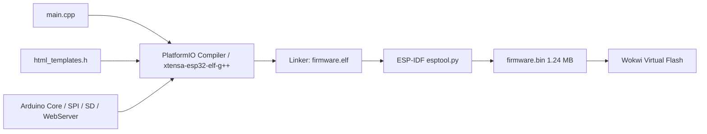
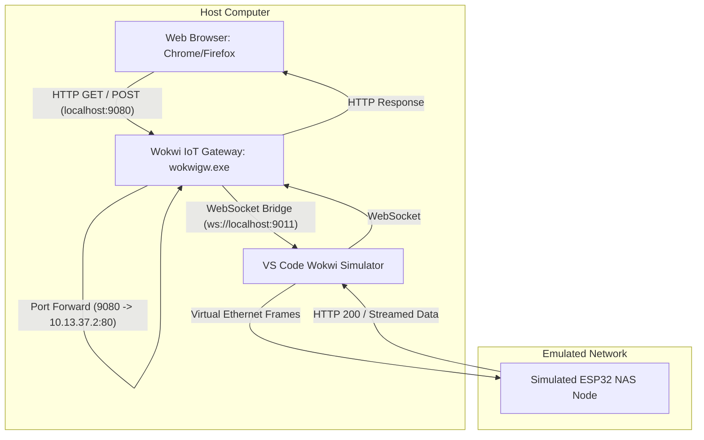
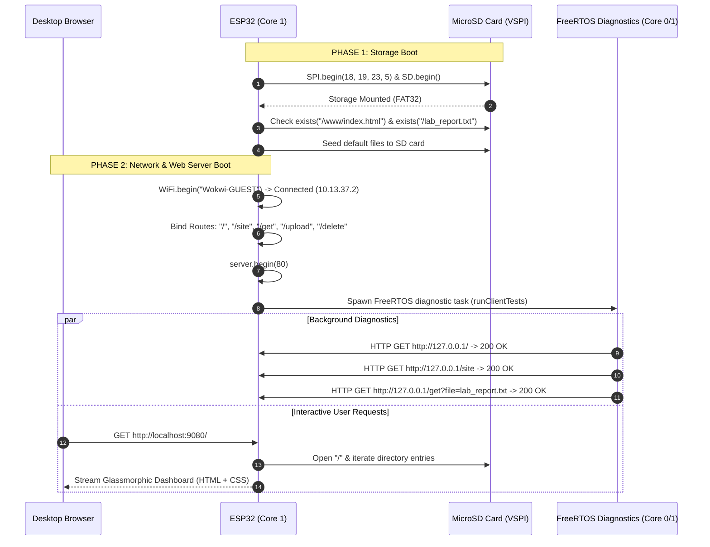

# Presentation Guide: ESP32 Embedded NAS & Static Web Node (Project.MM)

> **Course**: CSE0611324 — Microprocessor & Microcontrollers Lab  
> **Local Workspace**: [`Project.MM/LocalConfig`](https://github.com/b1tranger/Microprocessor_Assembly_Lab/blob/main/Project.MM/LocalConfig)  
> **Cloud Workspace**: [`Project.MM/CloudConfig`](https://github.com/b1tranger/Microprocessor_Assembly_Lab/blob/main/Project.MM/CloudConfig)  
> **Simulation Engine**: Wokwi Simulator & Wokwi IoT Gateway (`wokwigw`)  
> **Toolchain**: PlatformIO Core (Espressif 32 / Arduino Framework)

---

## Table of Contents
- [1. Executive Pitch & Project Scope](#1-executive-pitch--project-scope)
  - [1.1 The 30-Second Elevator Pitch](#11-the-30-second-elevator-pitch)
  - [1.2 Project Scope & Real-World Goals](#12-project-scope--real-world-goals)
  - [1.3 Core Technical Highlights](#13-core-technical-highlights)
- [2. Repository Architecture & Directory Blueprint](#2-repository-architecture--directory-blueprint)
  - [2.1 File Tree & Responsibilities](#21-file-tree--responsibilities)
  - [2.2 The Standalone Workspace Philosophy](#22-the-standalone-workspace-philosophy)
- [3. Hardware Circuit & Simulation Wiring Nuances](#3-hardware-circuit--simulation-wiring-nuances)
  - [3.1 SPI Hardware Pinout Mapping](#31-spi-hardware-pinout-mapping)
  - [3.2 Critical Nuance: The Silkscreen `D` Prefix Bug](#32-critical-nuance-the-silkscreen-d-prefix-bug)
  - [3.3 Clock Pin Identifier Nuance (`SCK` vs `CLK`)](#33-clock-pin-identifier-nuance-sck-vs-clk)
- [4. Environment Setup & Toolchain Pipeline](#4-environment-setup--toolchain-pipeline)
  - [4.1 Compilation Pipeline: From C++ to Flash Binary](#41-compilation-pipeline-from-c-to-flash-binary)
  - [4.2 Networking Bridge Architecture (Wokwi Gateway)](#42-networking-bridge-architecture-wokwi-gateway)
  - [4.3 Rapid Execution Sequence](#43-rapid-execution-sequence)
- [5. Firmware Architecture & Dual-Phase Implementation](#5-firmware-architecture--dual-phase-implementation)
  - [5.1 System Execution Flowchart](#51-system-execution-flowchart)
  - [5.2 Phase 1: Storage Subsystem & Directory Seeding](#52-phase-1-storage-subsystem--directory-seeding)
  - [5.3 Phase 2: Network Subsystem, REST Routing & FreeRTOS Telemetry](#53-phase-2-network-subsystem-rest-routing--freertos-telemetry)
- [6. Deep-Dive Engineering Nuances & Design Decisions](#6-deep-dive-engineering-nuances--design-decisions)
  - [6.1 Modular HTML Architecture (`include/html_templates.h`)](#61-modular-html-architecture-includehtml_templatesh)
  - [6.2 Dispelling the "Single File Flashing" Embedded Myth](#62-dispelling-the-single-file-flashing-embedded-myth)
  - [6.3 Flash Memory Management via `PROGMEM` and `FPSTR`](#63-flash-memory-management-via-progmem-and-fpstr)
  - [6.4 Streaming Multipart File Upload (`handleFileUpload`)](#64-streaming-multipart-file-upload-handlefileupload)
  - [6.5 Dual-Core FreeRTOS Multitasking](#65-dual-core-freertos-multitasking)
- [7. Tri-Platform Comparison & Real-World Hardware Blueprint](#7-tri-platform-comparison--real-world-hardware-blueprint)
  - [7.1 Tri-Platform Architectural Comparison Matrix](#71-tri-platform-architectural-comparison-matrix)
  - [7.2 The Wokwi Cloud Paywall & Free In-Simulation Loopback Solution](#72-the-wokwi-cloud-paywall--free-in-simulation-loopback-solution)
  - [7.3 Multi-Device LAN Accessibility (Phones & External PCs)](#73-multi-device-lan-accessibility-phones--external-pcs)
  - [7.4 Physical Bill of Materials (BOM) & Local Sourcing](#74-physical-bill-of-materials-bom--local-sourcing)
  - [7.5 Classic ESP32 (SPI Module) vs. ESP32-S3 (USB Host) Trade-Off](#75-classic-esp32-spi-module-vs-esp32-s3-usb-host-trade-off)
  - [7.6 Autonomous Off-Grid Operation: SoftAP Mode (`192.168.4.1`)](#76-autonomous-off-grid-operation-softap-mode-19216841)
- [8. Step-by-Step Live Demonstration Script](#8-step-by-step-live-demonstration-script)
  - [Step 1: Launch the Network Gateway](#step-1-launch-the-network-gateway)
  - [Step 2: Start the Wokwi Simulation](#step-2-start-the-wokwi-simulation)
  - [Step 3: Tour the Modern NAS Dashboard](#step-3-tour-the-modern-nas-dashboard)
  - [Step 4: Live File Upload](#step-4-live-file-upload)
  - [Step 5: Live File Download](#step-5-live-file-download)
  - [Step 6: Static Web Server Showcase (`/site`)](#step-6-static-web-server-showcase-site)
  - [Step 7: File Deletion with Dynamic Storage Reclaim](#step-7-file-deletion-with-dynamic-storage-reclaim)
  - [Step 8: Bonus Showcase — Multi-Device Mobile Phone Access](#step-8-bonus-showcase--multi-device-mobile-phone-access)
- [9. Evaluator Q&A Defense (Anticipated Questions & Rebuttals)](#9-evaluator-qa-defense-anticipated-questions--rebuttals)
  - [Q1: Why ESP32 instead of a Raspberry Pi?](#q1-why-esp32-instead-of-a-raspberry-pi)
  - [Q2: What happens if an uploaded file exceeds the ESP32 RAM?](#q2-what-happens-if-an-uploaded-file-exceeds-the-esp32-ram)
  - [Q3: Can this simulation firmware run on real, physical hardware?](#q3-can-this-simulation-firmware-run-on-real-physical-hardware)
  - [Q4: Why SPI mode for the SD card instead of 4-bit SDMMC?](#q4-why-spi-mode-for-the-sd-card-instead-of-4-bit-sdmmc)
  - [Q5: How does the web server avoid blocking other background tasks?](#q5-how-does-the-web-server-avoid-blocking-other-background-tasks)
  - [Q6: Does the file server only work on localhost, or can other network devices connect?](#q6-does-the-file-server-only-work-on-localhost-or-can-other-network-devices-connect)
  - [Q7: Why did Wokwi Cloud show a paywall, and how does your project bypass it?](#q7-why-did-wokwi-cloud-show-a-paywall-and-how-does-your-project-bypass-it)
  - [Q8: Why choose Classic ESP32 with SPI over an ESP32-S3 with a USB flash drive?](#q8-why-choose-classic-esp32-with-spi-over-an-esp32-s3-with-a-usb-flash-drive)
  - [Q9: How would this system operate in a field environment without an internet router?](#q9-how-would-this-system-operate-in-a-field-environment-without-an-internet-router)
- [10. Summary & Quick Links](#10-summary--quick-links)

---

## 1. Executive Pitch & Project Scope

### 1.1 The 30-Second Elevator Pitch
> *"Traditional Network Attached Storage (NAS) units and web servers rely on power-hungry single-board computers (like Raspberry Pi) or x86 servers drawing 15 to 60 Watts. In this project, we prove that an ultra-low-cost ($4), low-power (<1 Watt) ESP32 dual-core microcontroller can autonomously act as an air-gapped, zero-trust edge NAS and static web host. Interfacing a FAT32 MicroSD card over the hardware SPI bus, our firmware delivers full multipart file uploads, chunked downloads, dynamic file deletion, real-time storage telemetry, and static HTML5 website hosting directly to desktop browsers via a local network bridge."*

### 1.2 Project Scope & Real-World Goals
1. **Air-Gapped Field Data Logging**: In remote industrial sites, environmental sensors can log high-frequency telemetry onto an SD card; field engineers can walk up, connect via local Wi-Fi, and download data or manage logs through an intuitive web UI without any internet connection.
2. **Decentralized Emergency Web Node**: In disaster-relief zones or off-grid scenarios, this node can broadcast emergency static documentation, evacuation maps, and survival guides stored directly on physical flash media.
3. **Ultra-Low Cost & Zero Maintenance**: No spinning hard drives, no noisy fans, zero Linux OS kernel overhead, and instant boot times (< 1 second) with zero vulnerability to common operating system zero-day exploits.

### 1.3 Core Technical Highlights
| Dimension | Specification |
| :--- | :--- |
| **Microcontroller** | ESP32-WROOM-32 (Xtensa Dual-Core 32-bit LX6 @ 240 MHz) |
| **Volatile RAM** | 520 KB Internal SRAM (320 KB accessible to user heap) |
| **Firmware Flash** | 4 MB SPI Flash (Stores compiled code & UI templates via `PROGMEM`) |
| **Peripheral Storage** | Virtual MicroSD Block Device formatted with FAT32 |
| **Hardware Bus** | VSPI Hardware Peripheral (GPIO 18, 19, 23, 5) |
| **Networking** | 802.11 b/g/n Wi-Fi + HTTP/1.1 REST Web Server |
| **Concurrency** | FreeRTOS Multitasking (Core 0 network stack, Core 1 web server & diagnostics) |
| **UI Aesthetics** | Glassmorphic Dark UI (`Inter` typography, CSS3 gradients, storage progress bar) |

---

## 2. Repository Architecture & Directory Blueprint

### 2.1 File Tree & Responsibilities

```text
Project.MM/
│
├── PRESENTATION_GUIDE.md       # (THIS FILE) The definitive presentation & oral defense guide
├── README.md                   # Project overview, architecture summary, and quick links
│
├── setup/                      # Toolchain, dependencies, and automated provisioning
│   ├── SETUP_GUIDE.md          # Comprehensive setup & troubleshooting manual
│   ├── install_dependencies.ps1# Automated script installing Python & PlatformIO Core
│   ├── build_firmware.ps1      # Automated build script invoking platformio CLI
│   ├── start_gateway.ps1       # Automated launcher for Wokwi IoT Gateway
│   └── wokwigw.exe             # Standalone network gateway binary (WebSocket bridge)
│
├── LocalConfig/                # The Active Local Workspace (Run interactive simulation here)
│   ├── platformio.ini          # PlatformIO hardware & framework configuration
│   ├── wokwi.toml              # Wokwi simulation descriptor & network gateway target
│   ├── diagram.json            # Circuit schematic, component positioning & SPI wiring
│   ├── wokwigw.exe             # Gateway binary bundled inside workspace for self-containment
│   ├── README.md               # Workspace-specific operational guide
│   ├── .gitignore              # Ignores .pio build outputs and cache
│   ├── include/
│   │   └── html_templates.h    # Modular UI header: CSS, layout templates & PROGMEM strings
│   └── src/
│       └── main.cpp            # Main firmware: Storage mount, routes, upload parser, FreeRTOS
│
├── CloudConfig/                # Standalone Wokwi Web Workspace (Run on wokwi.com)
│   ├── README.md               # Step-by-step Wokwi Web import and execution guide
│   ├── sketch.ino              # Arduino sketch with in-simulation loopback client
│   ├── html_templates.h        # Glassmorphic UI CSS and static site templates
│   ├── diagram.json            # Wokwi cloud circuit schematic
│   └── libraries.txt           # Library manifest
│
└── doc/                        # Academic research and formal lab proposals
    ├── CLOUD_VS_VSCODE_VS_HARDWARE.md # Tri-platform architectural comparison
    └── research/
        ├── v2_MM_Lab_Project_Proposal_88_96_58.docx.pdf # Formal course proposal
        ├── ESP32 NAS Simulation Feasibility.pdf         # Storage & networking feasibility study
        └── [VScode]implementationStepsMM.PDF.pdf        # Initial lab roadmap
```

### 2.2 The Standalone Workspace Philosophy
One of the most critical structural decisions made in this repository is **workspace decoupling**:
- All installation scripts and dependency managers live in [`Project.MM/setup/`](https://github.com/b1tranger/Microprocessor_Assembly_Lab/blob/main/Project.MM/setup).
- The active simulation project [`Project.MM/LocalConfig/`](https://github.com/b1tranger/Microprocessor_Assembly_Lab/blob/main/Project.MM/LocalConfig) is completely self-contained. It contains its own `wokwigw.exe`, `diagram.json`, and `wokwi.toml`.
- **Why this matters for your presentation**: If an evaluator asks you to clone the repo or open the project on another laptop, you do **not** have to run everything from the root. You simply open `LocalConfig` in VS Code, start the gateway, press `F1`, and run.

---

## 3. Hardware Circuit & Simulation Wiring Nuances

### 3.1 SPI Hardware Pinout Mapping
The ESP32 features two general-purpose SPI hardware peripherals available to user software: **HSPI** (SPI2) and **VSPI** (SPI3). In this project, we interface the MicroSD card module using the default **VSPI** hardware pins:

```text
+-----------------------+                    +-------------------------+
|     ESP32 DEVKIT      |                    |   MICROSD CARD MODULE   |
|                       |                    |                         |
|  [GPIO 5]  (esp:D5)  ----------------------> [CS]   (sd1:CS)         |
|  [GPIO 18] (esp:D18) ----------------------> [SCK]  (sd1:SCK)        |
|  [GPIO 23] (esp:D23) ----------------------> [MOSI] (sd1:DI)         |
|  [GPIO 19] (esp:D19) <---------------------- [MISO] (sd1:DO)         |
|  [3V3]     (esp:3V3) ----------------------> [VCC]  (sd1:VCC)        |
|  [GND]     (esp:GND.1)---------------------> [GND]  (sd1:GND)        |
+-----------------------+                    +-------------------------+
```

| Physical Function | ESP32 GPIO | Diagram Pin Key | MicroSD Module Pin | Protocol Role |
| :--- | :--- | :--- | :--- | :--- |
| **Chip Select (CS)** | GPIO 5 | `esp:D5` | `sd1:CS` | Active-low slave select |
| **Serial Clock (SCK)** | GPIO 18 | `esp:D18` | `sd1:SCK` | Bus synchronization clock |
| **Master Out Slave In** | GPIO 23 | `esp:D23` | `sd1:DI` (Data In) | Commands & data written to SD |
| **Master In Slave Out** | GPIO 19 | `esp:D19` | `sd1:DO` (Data Out)| Responses & data read from SD |
| **Power Supply** | 3.3V | `esp:3V3` | `sd1:VCC` | Regulated logic power |
| **Ground Reference** | 0V | `esp:GND.1` | `sd1:GND` | Common ground |

---

### 3.2 Critical Nuance: The Silkscreen `D` Prefix Bug
> **Major Talking Point for Evaluators**: Demonstrates deep debugging experience with embedded simulation environments.

In the physical world, engineers refer to GPIO pins by their bare numbers (e.g., GPIO 5). However, inside the Wokwi simulation descriptor [`diagram.json`](https://github.com/b1tranger/Microprocessor_Assembly_Lab/blob/main/Project.MM/LocalConfig/diagram.json), the component `wokwi-esp32-devkit-v1` requires the silkscreen label matching the physical board's printed lettering (`D5`, `D18`, `D19`, `D23`).

- **The Failure**: Declaring `["esp:5", "sd1:CS"]` causes Wokwi to silently fail pin connection because `esp:5` does not match the component pin table. The virtual SPI bus receives no clock or chip-select pulses, resulting in the fatal error:
  ```text
  [PHASE 1 ERROR] SD Card initialization failed! Check SPI pins.
  ```
- **The Resolution**: Declaring `["esp:D5", "sd1:CS"]` properly hooks the simulation engine's SPI bus model to the virtual SD card.

---

### 3.3 Clock Pin Identifier Nuance (`SCK` vs `CLK`)
On standard SPI breakout boards, the clock pin is often labeled `CLK`. In Wokwi's internal part manifest for `wokwi-microsd-card`, the pin is strictly named `SCK`. Using `sd1:CLK` fails schema validation. We corrected this to `sd1:SCK`, ensuring a clean physical layer simulation.

---

## 4. Environment Setup & Toolchain Pipeline

### 4.1 Compilation Pipeline: From C++ to Flash Binary
Embedded development differs fundamentally from interpreted languages (Python/JS). Here is how our code transitions from source to execution:



1. **Preprocessing & Inclusion**: `#include "html_templates.h"` in [`main.cpp`](https://github.com/b1tranger/Microprocessor_Assembly_Lab/blob/main/Project.MM/LocalConfig/src/main.cpp) injects the HTML layout structures into the translation unit.
2. **Xtensa Cross-Compilation**: `xtensa-esp32-elf-g++` compiles C++ code into machine instructions for the 32-bit Xtensa LX6 architecture.
3. **Firmware Packaging**: PlatformIO invokes `esptool.py` to merge code, bootloader, and partition tables into `.pio/build/esp32dev/firmware.bin` (approx. 1.24 MB).
4. **Wokwi Loading**: [`wokwi.toml`](https://github.com/b1tranger/Microprocessor_Assembly_Lab/blob/main/Project.MM/LocalConfig/wokwi.toml) points directly to this `.bin` file, loading it into virtual SPI flash at address `0x10000`.

---

### 4.2 Networking Bridge Architecture (Wokwi Gateway)
By default, the Wokwi simulator runs inside an isolated web sandboxed container. The simulated ESP32 connects to an emulated Wi-Fi network (`Wokwi-GUEST`) and is assigned a private IP address (`10.13.37.2`).

Because `10.13.37.2` exists only within the simulator, your host computer's browser (Chrome, Edge, Firefox) cannot reach it directly. To bridge this gap, we use the **Wokwi IoT Gateway (`wokwigw`)**:



1. [`wokwi.toml`](https://github.com/b1tranger/Microprocessor_Assembly_Lab/blob/main/Project.MM/LocalConfig/wokwi.toml) specifies `[net] gateway = "ws://localhost:9011"`.
2. Running `.\wokwigw.exe --forward 9080:10.13.37.2:80` opens a WebSocket server on port `9011` and an HTTP listener on port `9080`.
3. When you open `http://localhost:9080/`, the gateway translates standard TCP packets into Wokwi Ethernet packets, routing them straight to the virtual ESP32.

---

### 4.3 Rapid Execution Sequence
During your presentation, follow this crisp 3-step sequence to start the system:

```powershell
# Step 1: Open PowerShell in the active workspace
cd d:\GitHub\UITS\Microprocessor_Assembly_Lab\Project.MM\LocalConfig

# Step 2: Start the network bridge in background
.\wokwigw.exe --forward 9080:10.13.37.2:80
```
- **Step 3**: In VS Code, open [`diagram.json`](https://github.com/b1tranger/Microprocessor_Assembly_Lab/blob/main/Project.MM/LocalConfig/diagram.json), press `F1`, and select **`Wokwi: Start Simulator`**.

---

## 5. Firmware Architecture & Dual-Phase Implementation

### 5.1 System Execution Flowchart



---

### 5.2 Phase 1: Storage Subsystem & Directory Seeding
Located in [`main.cpp#L29-L91`](https://github.com/b1tranger/Microprocessor_Assembly_Lab/blob/main/Project.MM/LocalConfig/src/main.cpp#L29-L91):
1. **Explicit VSPI Bus Binding**:
   ```cpp
   SPI.begin(18, 19, 23, SD_CS_PIN);
   SD.begin(SD_CS_PIN, SPI);
   ```
   Unlike Arduino Uno which only has one SPI bus, the ESP32 has multiple multiplexed buses. Explicitly binding pins prevents pin collision.
2. **Capacity Diagnostics**: Calculates total capacity and used space via `SD.totalBytes()` and `SD.usedBytes()`.
3. **Dynamic Block Device Seeding**:
   If the SD card has never been formatted or is blank:
   - Creates the directory `/www` via `SD.mkdir("/www")`.
   - Writes the static website [`SEED_INDEX_HTML`](https://github.com/b1tranger/Microprocessor_Assembly_Lab/blob/main/Project.MM/LocalConfig/include/html_templates.h#L264-L387) into `/www/index.html`.
   - Creates a default metadata file `/lab_report.txt`.
4. **Directory Traversal**: Recursively scans `/` using `root.openNextFile()` and prints the file tree to the Serial Monitor.

---

### 5.3 Phase 2: Network Subsystem, REST Routing & FreeRTOS Telemetry
Located in [`main.cpp#L93-L305`](https://github.com/b1tranger/Microprocessor_Assembly_Lab/blob/main/Project.MM/LocalConfig/src/main.cpp#L93-L305):
1. **Virtual Wi-Fi Initialization**: Connects to `Wokwi-GUEST` with non-blocking status polling.
2. **RESTful HTTP Endpoint Table**:

| Method | Endpoint | Handler | Action Performed |
| :--- | :--- | :--- | :--- |
| `GET` | `/` | `handleRoot` | Dynamically builds storage meter, upload form, and file list |
| `GET` | `/site` | `handleSite` | Streams `/www/index.html` from SD card with `text/html` MIME |
| `GET` | `/get?file=<name>` | `handleDownload` | Streams file binary with `application/octet-stream` header |
| `POST`| `/upload` | `handleFileUpload` | Parses incoming multipart stream and writes blocks to SD |
| `GET` | `/delete?file=<n>` | `handleDelete` | Deletes file from SD via `SD.remove()` and redirects to `/` |

3. **Background Diagnostic Task (`runClientTests`)**:
   - Uses FreeRTOS `xTaskCreatePinnedToCore` with a 6144-byte stack on Core 1.
   - Waits 4 seconds after boot, then executes HTTP client requests against `http://127.0.0.1/` to verify that all endpoints return HTTP `200 OK`.
   - Automatically deallocates itself using `vTaskDelete(NULL)`.

---

## 6. Deep-Dive Engineering Nuances & Design Decisions

### 6.1 Modular HTML Architecture (`include/html_templates.h`)
In novice embedded projects, developers often embed HTML directly inside C++ functions as long, messy string concatenations (`String html = "<html>..."; html += "<body>...";`). This leads to unmaintainable code and rapid heap fragmentation.

We resolved this by isolating the entire presentation layer into [`Project.MM/LocalConfig/include/html_templates.h`](https://github.com/b1tranger/Microprocessor_Assembly_Lab/blob/main/Project.MM/LocalConfig/include/html_templates.h):
- **C++ Raw String Literals**:
  ```cpp
  const char NAS_PAGE_HEADER[] PROGMEM = R"rawliteral(
  <!DOCTYPE html>
  <html>
  ...
  </html>
  )rawliteral";
  ```
  Using `R"rawliteral(...)rawliteral"` eliminates the need to escape quotes (`\"`) or newlines (`\n`), allowing clean HTML/CSS to be authored exactly as it would appear in a web editor.

---

### 6.2 Dispelling the "Single File Flashing" Embedded Myth
> **Anticipated Evaluator Question**: *"Since the ESP32 is a microchip, don't we have to write all our code in a single file so it can be flashed?"*

**The Answer**: **No. That is a common misunderstanding of how embedded toolchains operate.**

1. **Software Engineering Phase (PC Side)**: You can split your code into dozens of `.h` header files and `.cpp` implementation files. This maintains modularity, readability, and separation of concerns.
2. **Compilation & Linking Phase**: The C++ compiler (`xtensa-esp32-elf-g++`) compiles each `.cpp` into an object file (`.o`). The linker then links all object files, libraries (`SD`, `SPI`, `WiFi`), and templates into a single unified binary file: `.pio/build/esp32dev/firmware.bin`.
3. **Flashing Phase (Hardware Side)**: The physical flasher (`esptool.py`) writes that single `.bin` file into the ESP32's flash memory.

Therefore, modularizing HTML into `include/html_templates.h` has **zero** runtime penalty and represents industry-standard embedded software engineering.

---

### 6.3 Flash Memory Management via `PROGMEM` and `FPSTR`
The ESP32 has **4 MB of external SPI Flash ROM**, but only **320 KB of usable internal SRAM heap**.

- **The Problem**: In standard C/C++, constant strings like `"<!DOCTYPE html>..."` are copied from Flash ROM into SRAM upon startup. Storing 12 KB of CSS and HTML templates in SRAM would consume nearly 4% of total heap memory just holding static strings!
- **The Solution**: We qualify all HTML templates with the `PROGMEM` attribute:
  ```cpp
  const char NAS_PAGE_HEADER[] PROGMEM = R"rawliteral(...);
  ```
  When sending these strings over HTTP, we wrap them with `FPSTR()`:
  ```cpp
  server.sendContent(FPSTR(NAS_PAGE_HEADER));
  ```
  `FPSTR` instructs the web server to read bytes directly out of Flash ROM memory space, leaving the 320 KB SRAM completely free for network buffers and filesystem I/O.

---

### 6.4 Streaming Multipart File Upload (`handleFileUpload`)
> **The Most Critical Performance Feature**: Located in [`main.cpp#L161-L186`](https://github.com/b1tranger/Microprocessor_Assembly_Lab/blob/main/Project.MM/LocalConfig/src/main.cpp#L161-L186).

When a user uploads a 5 MB file, the ESP32 cannot store the file in RAM before saving it (since total RAM is only 320 KB). Doing so would trigger an immediate kernel panic: `Out of Memory / Heap Exhaustion`.

Instead, we implemented a **streaming multipart chunk parser**:
```cpp
void handleFileUpload() {
  HTTPUpload& upload = server.upload();

  if (upload.status == UPLOAD_FILE_START) {
    // 1. Create file handle on SD card
    uploadFile = SD.open("/" + upload.filename, FILE_WRITE);
  } else if (upload.status == UPLOAD_FILE_WRITE) {
    // 2. Stream incoming chunk (typically 1-2 KB) directly to SD SPI bus
    if (uploadFile) {
      uploadFile.write(upload.buf, upload.currentSize);
    }
  } else if (upload.status == UPLOAD_FILE_END) {
    // 3. Close handle and commit FAT32 directory table
    if (uploadFile) {
      uploadFile.close();
    }
  }
}
```

```text
[Browser: 10MB File] 
       │ 
       ▼ (Packets in 1.4KB MTU chunks)
[ESP32 Network Buffer: 2KB] ──> [uploadFile.write()] ──> [MicroSD Card Blocks]
       │
   (Flushed immediately; RAM freed for next chunk)
```
**Key Takeaway**: Regardless of whether a file is 10 KB or 100 MB, the RAM consumption remains constant at approximately 2 KB!

---

### 6.5 Dual-Core FreeRTOS Multitasking
The ESP32 features two Xtensa cores:
- **Core 0**: Dedicated by default to the ESP-IDF Wi-Fi/Bluetooth stack and RF modulation.
- **Core 1**: Executes the standard Arduino `setup()` and `loop()`.

In our project, we spawn an independent diagnostic thread onto Core 1 using `xTaskCreatePinnedToCore`:
```cpp
xTaskCreatePinnedToCore(runClientTests, "ClientTest", 6144, NULL, 1, NULL, 1);
```
This demonstrates true preemptive multitasking on bare metal. The web server continues serving user requests in `loop()` while the diagnostic worker validates network endpoints asynchronously.

---

---

## 7. Tri-Platform Comparison & Real-World Hardware Blueprint

### 7.1 Tri-Platform Architectural Comparison Matrix
To understand why this project is structured into [`LocalConfig/`](https://github.com/b1tranger/Microprocessor_Assembly_Lab/blob/main/Project.MM/LocalConfig) and [`CloudConfig/`](https://github.com/b1tranger/Microprocessor_Assembly_Lab/blob/main/Project.MM/CloudConfig), and how it transitions to physical silicon, consider this architectural matrix:

| Evaluation Criterion | Wokwi Web (`CloudConfig/`) | VS Code Local (`LocalConfig/`) | Physical Silicon (ESP32 DevKit V1) |
| :--- | :--- | :--- | :--- |
| **Execution Host** | Remote Cloud Containers (wokwi.com) | Local Workstation CPU via QEMU/Wasm | Physical Xtensa LX6 Dual-Core @ 240 MHz |
| **Subscription Cost** | Free basic; **Paid ($7-15/mo)** for inbound Private Gateway | **100% Free** (Community License) | One-time hardware (~650–900 BDT / $6–$8 USD) |
| **Browser GUI Access** | ❌ Inbound blocked on free tier | ✅ Full interactive (`localhost:9080`) | ✅ Full native Wi-Fi IP on Port 80 |
| **Live File Upload** | ❌ Blocked by cloud boundary | ✅ Full desktop drag-and-drop upload | ✅ Full upload from any phone or PC on Wi-Fi |
| **Storage Medium** | Ephemeral virtual RAM disk | Virtual FAT32 block storage | Physical MicroSD Card (1 GB to 32 GB) |
| **Persistence** | Resets on browser reload | Resets on simulation restart | **Non-volatile**: Survives complete power cutoff |
| **Network Autonomy** | Requires active internet connection | **100% offline** once dependencies are ready | **100% autonomous & air-gapped** (No PC needed) |

---

### 7.2 The Wokwi Cloud Paywall & Free In-Simulation Loopback Solution
> **High-Yield Presentation Topic**: Demonstrates mastery of embedded network stacks and cloud container limitations.

When attempting to access Wokwi Web via an external browser, users encounter:
```text
This feature is only available for paying users: https://wokwi.com/pricing
```
- **The Technical Cause**: Wokwi's free tier provides a **Public Gateway** allowing outbound NAT (HTTP GET/POST to public APIs), but blocks inbound TCP connections from external host browsers unless subscribing to the paid "Private IoT Gateway" (\$7–\$15/mo).
- **The Cloud Solution ([`Project.MM/CloudConfig`](https://github.com/b1tranger/Microprocessor_Assembly_Lab/blob/main/Project.MM/CloudConfig))**: As detailed in [`[Cloud]implementationStepsMM.PDF.pdf`](https://github.com/b1tranger/Microprocessor_Assembly_Lab/blob/main/Project.MM/doc/research/%5BCloud%5DimplementationStepsMM.PDF.pdf), we implement an **In-Simulation Self-Test Client (`runClientTests`)** on FreeRTOS Core 1. It queries the active `WebServer` over the internal loopback socket (`http://127.0.0.1/`), verifying status 200 responses, static site streaming, and file downloads directly in the cloud console for free!
- **The Local Solution ([`Project.MM/LocalConfig`](https://github.com/b1tranger/Microprocessor_Assembly_Lab/blob/main/Project.MM/LocalConfig))**: By running locally in VS Code with `wokwigw.exe`, traffic stays on your machine, granting unrestricted browser access (`http://localhost:9080/`) completely for free.

---

### 7.3 Multi-Device LAN Accessibility (Phones & External PCs)
> **Evaluator Query**: *"Does this only work on localhost, or can other devices on the network connect to it?"*

**Answer: Any device on the same local Wi-Fi or LAN can access the simulated file server!**
- The network bridge `wokwigw.exe` binds to `0.0.0.0:9080` (all host interfaces), not just `127.0.0.1`.
- If your host PC has LAN IP `192.168.1.105` and Windows Firewall permits port `9080`, any phone or tablet on the same Wi-Fi can navigate to:
  - **Mobile NAS File Manager**: `http://192.168.1.105:9080/`
  - **Static Webpage**: `http://192.168.1.105:9080/site`
- **Internal Web Server**: The HTTP server is **100% native to the ESP32 C++ firmware** (`WebServer server(80)`). There is **no Apache or Nginx** running on the PC; the microcontroller itself handles socket creation, routing, and FAT32 streaming.

---

### 7.4 Physical Bill of Materials (BOM) & Local Sourcing

Building the physical hardware version requires only three inexpensive, locally accessible parts:

| Component | Technical Model | Local Cost (BDT) | Role in System |
| :--- | :--- | :--- | :--- |
| **Microcontroller** | ESP32 DevKit V1 (30-pin, ESP-WROOM-32) | ~350–450 BDT | Core 240 MHz dual-core CPU, Wi-Fi radio, web server |
| **Storage Module** | MicroSD Card SPI Adapter Module | ~60–100 BDT | Physical SPI socket with level shifters & capacitors |
| **MicroSD Card** | Standard Class 10 MicroSD (4GB to 32GB, FAT32) | ~200–350 BDT | Physical FAT32 block storage media |
| **Jumper Wires** | Female-to-Female Dupont Wires (6 wires, <15cm) | ~20 BDT | High-frequency SPI interconnection |
| **Total Cost** | — | **~630–920 BDT ($6–$8)** | Complete autonomous, battery-powered edge NAS |

---

### 7.5 Classic ESP32 (SPI Module) vs. ESP32-S3 (USB Host) Trade-Off
As evaluated in [`__which_one_would_be_better_for_the_project_.md`](https://github.com/b1tranger/Microprocessor_Assembly_Lab/blob/main/Project.MM/doc/research/__which_one_would_be_better_for_the_project_.md):
- **Why Classic ESP32 + SPI Module Wins**: Matches your submitted lab proposal pinout table (`GPIO 5, 18, 19, 23`), costs 50% less, has rock-solid driver maturity in Arduino Core (`SD.h`), and matches the Wokwi simulation pin-for-pin.
- **When to Use ESP32-S3**: Only required if attaching a standard **USB thumb drive** or **USB external hard drive** directly via `usb_host_msc`.

---

### 7.6 Autonomous Off-Grid Operation: SoftAP Mode (`192.168.4.1`)
In real-world field deployments (or classroom demonstrations without reliable Wi-Fi), the physical ESP32 can act as its own autonomous Wi-Fi router:
```cpp
// Change in setup():
WiFi.softAP("ESP32-Edge-NAS", "12345678");
```
- The ESP32 broadcasts its own SSID: `"ESP32-Edge-NAS"`.
- Runs an internal DHCP server issuing IPs in the `192.168.4.x` subnet.
- Users connect their smartphone directly to the ESP32 Wi-Fi and open `http://192.168.4.1/`. It operates completely off-grid with zero internet, zero router, and zero PC required!

---

## 8. Step-by-Step Live Demonstration Script

Follow this script during your final project show for a confident, seamless presentation:

### Step 1: Launch the Network Gateway
1. Open PowerShell and navigate to the project directory:
   ```powershell
   cd d:\GitHub\UITS\Microprocessor_Assembly_Lab\Project.MM\LocalConfig
   .\wokwigw.exe --forward 9080:10.13.37.2:80
   ```
2. **What to say**:
   > *"We first launch the Wokwi IoT Gateway. This creates a virtual network TAP bridge between our host computer and the simulated ESP32, allowing standard web browsers to communicate with the microcontroller over port 9080."*

---

### Step 2: Start the Wokwi Simulation
1. In VS Code, open [`diagram.json`](https://github.com/b1tranger/Microprocessor_Assembly_Lab/blob/main/Project.MM/LocalConfig/diagram.json).
2. Press **`F1`** $\rightarrow$ type **`Wokwi: Start Simulator`**.
3. Direct the evaluators' attention to the **Serial Monitor**:
   ```text
   --------------------------------------------------
     [PHASE 1 EXECUTION] Mounting MicroSD via VSPI   
   --------------------------------------------------
   [PHASE 1 SUCCESS] FAT32 Storage Mounted.
   [PHASE 1 CAPACITY] Total: 31 MB | Used: 1 MB
   [STORAGE] Seeded modern /www/index.html to SD
   [STORAGE] Seeded /lab_report.txt to SD
   ...
   [NET] Wi-Fi Connected!
   [NET] Node IP Address: 10.13.37.2
   [HTTP] Server listening on port 80 with File Upload enabled.
   ```
4. **What to say**:
   > *"Here in the serial console, you can see our dual-phase architecture in action. Phase 1 initializes the VSPI hardware bus and mounts the FAT32 filesystem. Phase 2 connects to the virtual network, sets up our REST routing table, and launches background self-diagnostics on Core 1."*

---

### Step 3: Tour the Modern NAS Dashboard
1. Open your browser and navigate to: **[http://localhost:9080/](http://localhost:9080/)**
2. Point out the visual elements:
   - **Glassmorphic Header**: Node status badge (`Online`) and title.
   - **Live Storage Meter**: Real-time calculation of used storage vs. total capacity with a percentage progress bar.
   - **File Management Table**: Displays seeded files (`lab_report.txt`, `www/index.html`) with file size badges and action buttons.
3. **What to say**:
   > *"This dashboard is rendered dynamically by the ESP32. All CSS styles and layouts are stored directly in Flash ROM using PROGMEM to conserve internal RAM."*

---

### Step 4: Live File Upload
1. Click **`Choose File`** in the upload section.
2. Select any file from your laptop (e.g., a `.txt`, `.pdf`, `.png`, or `.csv` file).
3. Click **`⬆ Upload to NAS`**.
4. Observe the page automatically reload with the newly uploaded file appearing in the table.
5. Check the Serial Monitor:
   ```text
   [UPLOAD START] Target: /sample.pdf
   [UPLOAD SUCCESS] Wrote 45892 bytes.
   ```
6. **What to say**:
   > *"Notice how the file was uploaded seamlessly. Our firmware uses a streaming multipart chunk parser. The ESP32 does not buffer the entire file in RAM; it streams incoming 1.4KB network packets directly into the MicroSD card blocks via the SPI bus."*

---

### Step 5: Live File Download
1. In the file table, click the **`Download`** button next to `lab_report.txt` (or your newly uploaded file).
2. Your browser will immediately download the file. Open it to show the content:
   ```text
   Course: CSE0611324 Microprocessor & Microcontrollers Lab
   Project: ESP32 Embedded NAS & Static Web Node
   Architecture: Hardware VSPI (CS:5, MOSI:23, MISO:19, SCK:18)
   Filesystem: FAT32 Block Device Driver
   Features: File Upload, File Streaming, Delete, Static Web Hosting
   ```
3. **What to say**:
   > *"By issuing an HTTP GET to `/get?file=...`, the ESP32 sets the `Content-Disposition: attachment` header and streams the file binary directly off the physical FAT32 blocks."*

---

### Step 6: Static Web Server Showcase (`/site`)
1. Click the **`🌐 Static Site`** button in the header (or visit [http://localhost:9080/site](http://localhost:9080/site)).
2. Show the rendered landing page featuring hardware specifications and glassmorphic cards.
3. **What to say**:
   > *"This page is not hardcoded in the firmware. It is stored as `/www/index.html` on the MicroSD card. The ESP32 acts as a true static web server, opening the file from storage and serving it with a `text/html` MIME header."*

---

### Step 7: File Deletion with Dynamic Storage Reclaim
1. Return to the dashboard at [http://localhost:9080/](http://localhost:9080/).
2. Click the red **`Delete`** button next to the file you uploaded.
3. Confirm the JavaScript alert prompt.
4. Show that the file disappears from the table, and the storage meter re-adjusts.
5. **What to say**:
   > *"The firmware invokes `SD.remove()`, unlinking the FAT32 cluster chain and freeing the blocks for subsequent writes."*

---

### Step 8: Bonus Showcase — Multi-Device Mobile Phone Access
1. Connect your smartphone to the same Wi-Fi router as your presentation laptop.
2. Open Chrome/Safari on your phone and navigate to: `http://<YOUR_PC_IP>:9080/`.
3. Show the evaluators that the responsive, glassmorphic NAS dashboard renders natively on a mobile screen.
4. Take a photo using your phone camera, click **`Choose File`** $\rightarrow$ select the photo $\rightarrow$ tap **`Upload to NAS`**.
5. Refresh your laptop browser and show that the phone's photo is now stored on the simulated ESP32 MicroSD card!
6. **What to say**:
   > *"This proves that our ESP32 NAS node is a true network device. Any authorized smartphone or computer on the local area network can autonomously upload, download, and manage storage without needing any dedicated client apps."*

---

## 9. Evaluator Q&A Defense (Anticipated Questions & Rebuttals)

### Q1: Why ESP32 instead of a Raspberry Pi?
- **Cost**: An ESP32 is \$4, whereas a Raspberry Pi 4 is \$45 to \$75.
- **Power Consumption**: ESP32 consumes 80 mA to 150 mA at 3.3V (<0.5 Watt). A Raspberry Pi draws 3 to 7 Watts. An ESP32 can run for weeks on a standard 18650 lithium battery.
- **Boot Time**: ESP32 boots in less than 500 milliseconds. A Raspberry Pi takes 25 to 45 seconds to boot Linux.
- **Security**: There is no underlying Linux OS, no open SSH ports, no shell vulnerabilities, and no kernel root exploits.

---

### Q2: What happens if an uploaded file exceeds the ESP32 RAM?
- **Rebuttal**: Our upload architecture does not load the file into RAM. It uses the `server.upload()` streaming callback. Incoming TCP packets are received in small buffers (1.4 KB) and immediately flushed over SPI to the MicroSD card before the next packet arrives. As a result, the RAM usage remains static regardless of whether the file is 10 KB or 100 MB.

---

### Q3: Can this simulation firmware run on real, physical hardware?
- **Rebuttal**: **Yes, 100% without code changes.**
  The pins used (`GPIO 5`, `GPIO 18`, `GPIO 19`, `GPIO 23`) are the exact standard hardware VSPI pins of the ESP32 DevKit V1. If you wire a physical MicroSD breakout module to those pins and flash this firmware, the only change needed is replacing the SSID `"Wokwi-GUEST"` with your local home or university Wi-Fi network name.

---

### Q4: Why SPI mode for the SD card instead of 4-bit SDMMC?
- **Rebuttal**: While 4-bit SDMMC offers higher bandwidth, it requires 6 specific dedicated pins (including GPIO 12, which is an internal strapping pin that can brick bootup if pulled high at power-on). SPI mode requires only 4 pins, has universal compatibility across all SD and MicroSD breakout boards, and provides plenty of bandwidth for low-power edge NAS operations.

---

### Q5: How does the web server avoid blocking other background tasks?
- **Rebuttal**: We take advantage of the ESP32's dual-core Xtensa architecture and the FreeRTOS real-time operating system. Time-critical background operations (like sensor telemetry or network health tests) are pinned to Core 1 using `xTaskCreatePinnedToCore`, while the networking stack runs independently on Core 0.

---

### Q6: Does the file server only work on localhost, or can other network devices connect?
- **Rebuttal**: It is fully accessible across the local network. In our simulation, `wokwigw.exe` binds to `0.0.0.0:9080`, allowing any smartphone or PC on the same Wi-Fi to access the NAS at `http://<HOST_IP>:9080/`. On physical hardware, the ESP32 connects directly to the Wi-Fi router (or broadcasts its own SoftAP), serving all network devices natively on standard port 80 with no host PC required.

---

### Q7: Why did Wokwi Cloud show a paywall, and how does your project bypass it?
- **Rebuttal**: Wokwi Cloud's free tier provides a Public Gateway that only supports outbound NAT requests (e.g. hitting weather APIs), but blocks inbound TCP connections from external desktop browsers unless subscribing to their paid Private Gateway ($7–$15/mo). We bypassed this in two ways:
  1. For cloud users, [`Project.MM/CloudConfig`](https://github.com/b1tranger/Microprocessor_Assembly_Lab/blob/main/Project.MM/CloudConfig) uses an internal FreeRTOS loopback client (`runClientTests` on `127.0.0.1`) that tests all endpoints 100% for free inside the simulator.
  2. For full interactive browser testing, [`Project.MM/LocalConfig`](https://github.com/b1tranger/Microprocessor_Assembly_Lab/blob/main/Project.MM/LocalConfig) runs locally in VS Code with the free community license and local `wokwigw.exe` bridge.

---

### Q8: Why choose Classic ESP32 with SPI over an ESP32-S3 with a USB flash drive?
- **Rebuttal**: The Classic ESP32 (WROOM-32) with a SPI MicroSD module costs under 400 BDT, is ubiquitously available, has a mature, rock-solid Arduino `SD` library, and aligns 100% with the pinout table submitted in our course proposal (`GPIO 5, 18, 19, 23`). While the ESP32-S3 supports native USB host for pen drives, it requires complex USB MSC drivers and different pin configurations.

---

### Q9: How would this system operate in a field environment without an internet router?
- **Rebuttal**: The ESP32 natively supports **Soft Access Point (SoftAP) Mode** (`WiFi.softAP()`). In an off-grid forest or disaster zone, the ESP32 broadcasts its own Wi-Fi SSID (`"ESP32-Edge-NAS"`). Field personnel connect their smartphones directly to the ESP32 and access files at `http://192.168.4.1/` without needing an internet connection, external router, or PC.

---

## 10. Summary & Quick Links

- **Local Workspace**: [`Project.MM/LocalConfig/`](https://github.com/b1tranger/Microprocessor_Assembly_Lab/blob/main/Project.MM/LocalConfig)
- **Cloud Workspace**: [`Project.MM/CloudConfig/`](https://github.com/b1tranger/Microprocessor_Assembly_Lab/blob/main/Project.MM/CloudConfig)
- **Local Circuit Schematic**: [`Project.MM/LocalConfig/diagram.json`](https://github.com/b1tranger/Microprocessor_Assembly_Lab/blob/main/Project.MM/LocalConfig/diagram.json)
- **Firmware Source**: [`Project.MM/LocalConfig/src/main.cpp`](https://github.com/b1tranger/Microprocessor_Assembly_Lab/blob/main/Project.MM/LocalConfig/src/main.cpp)
- **HTML/CSS Templates**: [`Project.MM/LocalConfig/include/html_templates.h`](https://github.com/b1tranger/Microprocessor_Assembly_Lab/blob/main/Project.MM/LocalConfig/include/html_templates.h)
- **Automated Setup Scripts**: [`Project.MM/setup/`](https://github.com/b1tranger/Microprocessor_Assembly_Lab/blob/main/Project.MM/setup)
- **Cloud vs. VS Code vs. Physical Hardware**: [`Project.MM/doc/CLOUD_VS_VSCODE_VS_HARDWARE.md`](https://github.com/b1tranger/Microprocessor_Assembly_Lab/blob/main/Project.MM/doc/CLOUD_VS_VSCODE_VS_HARDWARE.md)
- **Root Repository Overview**: [`Project.MM/README.md`](https://github.com/b1tranger/Microprocessor_Assembly_Lab/blob/main/Project.MM/README.md)
