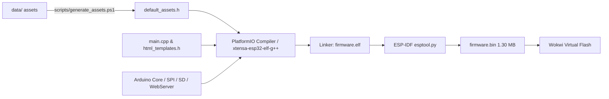
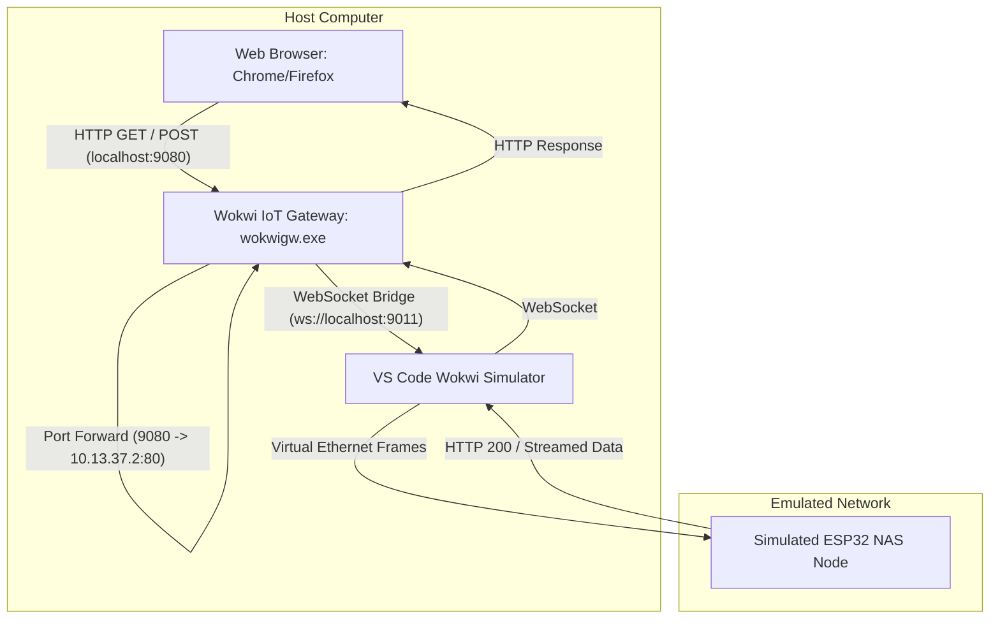
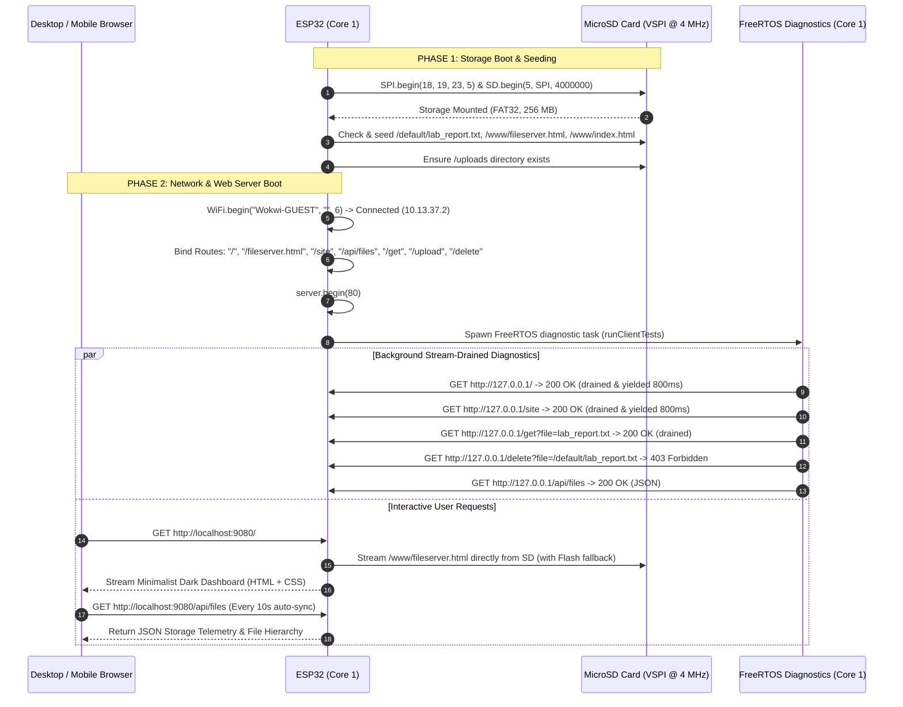

# Presentation Guide: ESP32 Embedded NAS & Static Web Node (Project.MM)

> **Course**: CSE0611324 — Microprocessor & Microcontrollers Lab  
> **Team Presentation Bridge (10-Minute Script & Roles)**: [`Project.MM/LocalConfig/presentationBridge.md`](https://github.com/b1tranger/Microprocessor_Assembly_Lab/blob/main/Project.MM/LocalConfig/presentationBridge.md)  
> **Local Workspace**: [`Project.MM/LocalConfig`](https://github.com/b1tranger/Microprocessor_Assembly_Lab/blob/main/Project.MM/LocalConfig)  
> **Cloud Workspace**: [`Project.MM/CloudConfig`](https://github.com/b1tranger/Microprocessor_Assembly_Lab/blob/main/Project.MM/CloudConfig)  
> **Simulation Engine**: Wokwi Simulator & Wokwi IoT Gateway (`wokwigw`)  
> **Toolchain**: PlatformIO Core (Espressif 32 / Arduino Framework)

---

## Table of Contents
- [1. Executive Pitch & Project Scope](#1-executive-pitch--project-scope)
  - [1.1 The 30-Second Elevator Pitch](#11-the-30-second-elevator-pitch)
  - [1.2 Project Scope & Real-World Goals](#12-project-scope--real-world-goals)
  - [1.3 Core Technical Highlights](#13-core-technical-highlights)
- [2. Repository Architecture & Directory Blueprint](#2-repository-architecture--directory-blueprint)
  - [2.1 File Tree & Responsibilities](#21-file-tree--responsibilities)
  - [2.2 The Standalone Workspace Philosophy](#22-the-standalone-workspace-philosophy)
- [3. Hardware Circuit & Simulation Wiring Nuances](#3-hardware-circuit--simulation-wiring-nuances)
  - [3.1 SPI Hardware Pinout Mapping](#31-spi-hardware-pinout-mapping)
  - [3.2 Critical Nuance: The Silkscreen `D` Prefix Bug](#32-critical-nuance-the-silkscreen-d-prefix-bug)
  - [3.3 Clock Pin Identifier Nuance (`SCK` vs `CLK`)](#33-clock-pin-identifier-nuance-sck-vs-clk)
- [4. Environment Setup & Toolchain Pipeline](#4-environment-setup--toolchain-pipeline)
  - [4.1 Compilation Pipeline: From C++ to Flash Binary](#41-compilation-pipeline-from-c-to-flash-binary)
  - [4.2 Networking Bridge Architecture (Wokwi Gateway)](#42-networking-bridge-architecture-wokwi-gateway)
  - [4.3 Rapid Execution Sequence](#43-rapid-execution-sequence)
  - [4.4 One-Click Build Refresh Automation (`refresh_firmware.bat` / `.ps1`)](#44-one-click-build-refresh-automation-refresh_firmwarebat--ps1)
- [5. Firmware Architecture & Dual-Phase Implementation](#5-firmware-architecture--dual-phase-implementation)
  - [5.1 System Execution Flowchart](#51-system-execution-flowchart)
  - [5.2 Phase 1: Storage Subsystem, 4 MHz VSPI & Directory Seeding](#52-phase-1-storage-subsystem-4-mhz-vspi--directory-seeding)
  - [5.3 Phase 2: Network Subsystem, REST Routing & Stream-Drained Diagnostics](#53-phase-2-network-subsystem-rest-routing--stream-drained-diagnostics)
- [6. Deep-Dive Engineering Nuances & Design Decisions](#6-deep-dive-engineering-nuances--design-decisions)
  - [6.1 Standalone Web Assets & Pre-Build Embedding (`data/www` & `default_assets.h`)](#61-standalone-web-assets--pre-build-embedding-datawww--default_assetsh)
  - [6.2 Dispelling the "Single File Flashing" Embedded Myth](#62-dispelling-the-single-file-flashing-embedded-myth)
  - [6.3 Flash Memory Management via `PROGMEM` and `FPSTR`](#63-flash-memory-management-via-progmem-and-fpstr)
  - [6.4 High-Throughput 4KB Sector-Aligned Multipart Upload & Abort Purging](#64-high-throughput-4kb-sector-aligned-multipart-upload--abort-purging)
  - [6.5 Loopback Network Speed vs. Simulated SPI Storage Latency (The 100% Transition)](#65-loopback-network-speed-vs-simulated-spi-storage-latency-the-100-transition)
  - [6.6 Dual-Core FreeRTOS Concurrency & Socket Resource Management](#66-dual-core-freertos-concurrency--socket-resource-management)
  - [6.7 Minimalist Industrial UI Philosophy & Mobile-First Touch Targets](#67-minimalist-industrial-ui-philosophy--mobile-first-touch-targets)
- [7. Tri-Platform Comparison & Real-World Hardware Blueprint](#7-tri-platform-comparison--real-world-hardware-blueprint)
  - [7.1 Tri-Platform Architectural Comparison Matrix](#71-tri-platform-architectural-comparison-matrix)
  - [7.2 The Wokwi Cloud Paywall & Free In-Simulation Loopback Solution](#72-the-wokwi-cloud-paywall--free-in-simulation-loopback-solution)
  - [7.3 Multi-Device LAN Accessibility (Phones & External PCs)](#73-multi-device-lan-accessibility-phones--external-pcs)
    - [7.3.1 LocalSend Web Model: 2-Computer Lab File Sharing](#731-localsend-web-model-2-computer-lab-file-sharing)
  - [7.4 Physical Bill of Materials (BOM) & Local Sourcing](#74-physical-bill-of-materials-bom--local-sourcing)
  - [7.5 Classic ESP32 (SPI Module) vs. ESP32-S3 (USB Host) Trade-Off](#75-classic-esp32-spi-module-vs-esp32-s3-usb-host-trade-off)
  - [7.6 Autonomous Off-Grid Operation: SoftAP Mode (`192.168.4.1`)](#76-autonomous-off-grid-operation-softap-mode-19216841)
- [8. Step-by-Step Live Demonstration Script](#8-step-by-step-live-demonstration-script)
  - [Step 1: Launch the Network Gateway](#step-1-launch-the-network-gateway)
  - [Step 2: Start the Wokwi Simulation](#step-2-start-the-wokwi-simulation)
  - [Step 3: Tour the Minimalist Dark NAS Dashboard](#step-3-tour-the-minimalist-dark-nas-dashboard)
  - [Step 4: Live File Upload with Real-Time Commit State](#step-4-live-file-upload-with-real-time-commit-state)
  - [Step 5: Live File Download](#step-5-live-file-download)
  - [Step 6: Static Web Server Showcase (`/site`)](#step-6-static-web-server-showcase-site)
  - [Step 7: File Deletion with Dynamic Storage Reclaim & Protection](#step-7-file-deletion-with-dynamic-storage-reclaim--protection)
  - [Step 8: Bonus Showcase — Multi-Device & 2-Computer LAN Access (LocalSend Web Model)](#step-8-bonus-showcase--multi-device--2-computer-lan-access-localsend-web-model)
  - [Step 9: Mobile Responsive Inspection (Icon-Only Actions)](#step-9-mobile-responsive-inspection-icon-only-actions)
- [9. Evaluator Q&A Defense (Anticipated Questions & Rebuttals)](#9-evaluator-qa-defense-anticipated-questions--rebuttals)
  - [Q1: Why ESP32 instead of a Raspberry Pi?](#q1-why-esp32-instead-of-a-raspberry-pi)
  - [Q2: What happens if an uploaded file exceeds the ESP32 RAM?](#q2-what-happens-if-an-uploaded-file-exceeds-the-esp32-ram)
  - [Q3: Can this simulation firmware run on real, physical hardware?](#q3-can-this-simulation-firmware-run-on-real-physical-hardware)
  - [Q4: Why SPI mode for the SD card instead of 4-bit SDMMC?](#q4-why-spi-mode-for-the-sd-card-instead-of-4-bit-sdmmc)
  - [Q5: How does the web server avoid blocking other background tasks?](#q5-how-does-the-web-server-avoid-blocking-other-background-tasks)
  - [Q6: Does the file server only work on localhost, or can other network devices connect?](#q6-does-the-file-server-only-work-on-localhost-or-can-other-network-devices-connect)
  - [Q7: Why did Wokwi Cloud show a paywall, and how does your project bypass it?](#q7-why-did-wokwi-cloud-show-a-paywall-and-how-does-your-project-bypass-it)
  - [Q8: Why choose Classic ESP32 with SPI over an ESP32-S3 with a USB flash drive?](#q8-why-choose-classic-esp32-with-spi-over-an-esp32-s3-with-a-usb-flash-drive)
  - [Q9: How would this system operate in a field environment without an internet router?](#q9-how-would-this-system-operate-in-a-field-environment-without-an-internet-router)
  - [Q10: How does this system compare to LocalSend / LocalSend Web?](#q10-how-does-this-system-compare-to-localsend--localsend-web)
  - [Q11: How do you handle campus Wi-Fi AP/Client Isolation during a lab demonstration?](#q11-how-do-you-handle-campus-wi-fi-apclient-isolation-during-a-lab-demonstration)
  - [Q12: Why is the dashboard styled with sharp geometry (border-radius: 0) and no animated status dot?](#q12-why-is-the-dashboard-styled-with-sharp-geometry-border-radius-0-and-no-animated-status-dot)
  - [Q13: Why did uploads stay stuck at 100% for several seconds before completing?](#q13-why-did-uploads-stay-stuck-at-100-for-several-seconds-before-completing)
  - [Q14: How does your firmware guarantee zero corrupted or 0-byte files if an upload is interrupted?](#q14-how-does-your-firmware-guarantee-zero-corrupted-or-0-byte-files-if-an-upload-is-interrupted)
  - [Q15: Why is the SPI clock initialized to 4 MHz rather than 25 MHz or 40 MHz?](#q15-why-is-the-spi-clock-initialized-to-4-mhz-rather-than-25-mhz-or-40-mhz)
  - [Q16: How does the asset generation pipeline allow web developers to modify HTML without editing C++ code?](#q16-how-does-the-asset-generation-pipeline-allow-web-developers-to-modify-html-without-editing-c-code)
- [10. Summary & Quick Links](#10-summary--quick-links)

---

## 1. Executive Pitch & Project Scope

### 1.1 The 30-Second Elevator Pitch
> *"Traditional Network Attached Storage (NAS) units and web servers rely on power-hungry single-board computers (like Raspberry Pi) or x86 servers drawing 15 to 60 Watts. In this project, we prove that an ultra-low-cost ($4), low-power (<1 Watt) ESP32 dual-core microcontroller can autonomously act as an air-gapped, zero-trust edge NAS and static web host. Interfacing a FAT32 MicroSD card over the hardware SPI bus, our firmware delivers full multipart file uploads, chunked downloads, dynamic file deletion, real-time storage telemetry, and static HTML5 website hosting directly to desktop browsers via a local network bridge."*

### 1.2 Project Scope & Real-World Goals
1. **Air-Gapped Field Data Logging**: In remote industrial sites, environmental sensors can log high-frequency telemetry onto an SD card; field engineers can walk up, connect via local Wi-Fi, and download data or manage logs through an intuitive web UI without any internet connection.
2. **Decentralized Emergency Web Node**: In disaster-relief zones or off-grid scenarios, this node can broadcast emergency static documentation, evacuation maps, and survival guides stored directly on physical flash media.
3. **Ultra-Low Cost & Zero Maintenance**: No spinning hard drives, no noisy fans, zero Linux OS kernel overhead, and instant boot times (< 1 second) with zero vulnerability to common operating system zero-day exploits.

### 1.3 Core Technical Highlights
| Dimension | Specification |
| :--- | :--- |
| **Microcontroller** | ESP32-WROOM-32 (Xtensa Dual-Core 32-bit LX6 @ 240 MHz) |
| **Volatile RAM** | 520 KB Internal SRAM (320 KB accessible to user heap) |
| **Firmware Flash** | 4 MB SPI Flash (Stores compiled code, assets & UI templates via `PROGMEM`) |
| **Peripheral Storage** | Virtual MicroSD Block Device formatted with FAT32 (256 MB max capacity in Wokwi) |
| **Hardware Bus** | VSPI Hardware Peripheral (GPIO 18, 19, 23, 5) clocked at reliable 4 MHz |
| **Networking** | 802.11 b/g/n Wi-Fi + HTTP/1.1 REST Web Server + `/api/files` JSON Telemetry |
| **Concurrency** | FreeRTOS Multitasking (Core 0 lwIP network stack, Core 1 WebServer & stream-drained diagnostics) |
| **UI Aesthetics** | Minimalist Dark Theme (Matte `#0c0d11`, `border-radius: 0`, icon-only mobile actions, 10s auto-sync) |

---

## 2. Repository Architecture & Directory Blueprint

### 2.1 File Tree & Responsibilities

```text
Project.MM/
│
├── PRESENTATION_GUIDE.md       # (THIS FILE) The definitive presentation & oral defense guide
├── README.md                   # Project overview, architecture summary, and quick links
│
├── LocalConfig/                # The Active Local Workspace (Run interactive simulation here)
│   ├── platformio.ini          # PlatformIO hardware & framework configuration
│   ├── wokwi.toml              # Wokwi simulation descriptor & 256 MB virtual SD mount
│   ├── diagram.json            # Circuit schematic, component positioning & SPI wiring
│   ├── wokwigw.exe             # Gateway binary bundled inside workspace for self-containment
│   ├── setup_firewall.bat      # One-click UAC auto-elevated Windows Firewall rule installer
│   ├── refresh_firmware.bat    # Double-clickable Windows batch launcher to refresh & rebuild firmware
│   ├── refresh_firmware.ps1    # Standalone PowerShell script syncing assets and compiling with PlatformIO
│   ├── build_firmware.bat      # Root build launcher alias
│   ├── runGuide.md             # Comprehensive execution, networking, and setup guide
│   ├── README.md               # Workspace-specific operational guide
│   ├── .gitignore              # Ignores .pio build outputs and cache
│   ├── data/                   # Dedicated host folders for initial assets & virtual SD
│   │   ├── default/            # Protected default assets (lab_report.txt, etc.)
│   │   ├── www/                # Editable web UI assets (fileserver.html & index.html)
│   │   └── network/            # Host folder mapped directly to simulated SD card (256 MB)
│   │       ├── default/        # Seeded default files
│   │       ├── www/            # Mirrored web server files served directly from SD
│   │       └── uploads/        # Upload destination directory for user files
│   ├── scripts/                # Asset compilation scripts
│   │   ├── generate_assets.bat # Batch asset generator
│   │   ├── generate_assets.ps1 # PowerShell asset generator (data/ -> include/default_assets.h)
│   │   └── generate_assets.py  # PlatformIO pre-build asset generator script
│   ├── include/
│   │   ├── default_assets.h    # Auto-generated C++ PROGMEM byte arrays embedded into Flash ROM
│   │   └── html_templates.h    # Modular UI header: Minimalist CSS, layout templates & PROGMEM strings
│   ├── setup/                  # Automated toolchain provisioning
│   │   ├── SETUP_GUIDE.md      # Comprehensive setup & troubleshooting manual
│   │   ├── install_dependencies.ps1 # Script installing Python & PlatformIO Core
│   │   ├── build_firmware.ps1  # Toolchain build script
│   │   └── start_gateway.ps1   # Automated launcher for Wokwi IoT Gateway
│   └── src/
│       └── main.cpp            # Main firmware: Storage mount, routes, 4KB buffered upload parser, FreeRTOS
│
├── CloudConfig/                # Standalone Wokwi Web Workspace (Run on wokwi.com)
│   ├── README.md               # Step-by-step Wokwi Web import and execution guide
│   ├── sketch.ino              # Arduino sketch with in-simulation loopback client
│   ├── html_templates.h        # Glassmorphic UI CSS and static site templates
│   ├── diagram.json            # Wokwi cloud circuit schematic
│   └── libraries.txt           # Library manifest
│
└── doc/                        # Academic research and formal lab proposals
    ├── CLOUD_VS_VSCODE_VS_HARDWARE.md # Tri-platform architectural comparison
    ├── note/                   # Theory and assembly notes
    ├── prompts/                # Full conversation archives and execution summaries
    └── research/
        ├── v2_MM_Lab_Project_Proposal_88_96_58.docx.pdf # Formal course proposal
        ├── ESP32 NAS Simulation Feasibility.pdf         # Storage & networking feasibility study
        └── [VScode]implementationStepsMM.PDF.pdf        # Initial lab roadmap
```

### 2.2 The Standalone Workspace Philosophy
One of the most critical structural decisions made in this repository is **workspace decoupling**:
- All installation scripts and dependency managers live in [`Project.MM/LocalConfig/setup/`](https://github.com/b1tranger/Microprocessor_Assembly_Lab/blob/main/Project.MM/LocalConfig/setup).
- The active simulation project [`Project.MM/LocalConfig/`](https://github.com/b1tranger/Microprocessor_Assembly_Lab/blob/main/Project.MM/LocalConfig) is completely self-contained. It contains its own `wokwigw.exe`, `diagram.json`, and `wokwi.toml`.
- **Why this matters for your presentation**: If an evaluator asks you to clone the repo or open the project on another laptop, you do **not** have to run everything from the root. You simply open `LocalConfig` in VS Code, start the gateway, press `F1`, and run.

---

## 3. Hardware Circuit & Simulation Wiring Nuances

### 3.1 SPI Hardware Pinout Mapping
The ESP32 features two general-purpose SPI hardware peripherals available to user software: **HSPI** (SPI2) and **VSPI** (SPI3). In this project, we interface the MicroSD card module using the default **VSPI** hardware pins:

```text
+-----------------------+                    +-------------------------+
|     ESP32 DEVKIT      |                    |   MICROSD CARD MODULE   |
|                       |                    |                         |
|  [GPIO 5]  (esp:D5)  ----------------------> [CS]   (sd1:CS)         |
|  [GPIO 18] (esp:D18) ----------------------> [SCK]  (sd1:SCK)        |
|  [GPIO 23] (esp:D23) ----------------------> [MOSI] (sd1:DI)         |
|  [GPIO 19] (esp:D19) <---------------------- [MISO] (sd1:DO)         |
|  [3V3]     (esp:3V3) ----------------------> [VCC]  (sd1:VCC)        |
|  [GND]     (esp:GND.1)---------------------> [GND]  (sd1:GND)        |
+-----------------------+                    +-------------------------+
```

| Physical Function | ESP32 GPIO | Diagram Pin Key | MicroSD Module Pin | Protocol Role |
| :--- | :--- | :--- | :--- | :--- |
| **Chip Select (CS)** | GPIO 5 | `esp:D5` | `sd1:CS` | Active-low slave select |
| **Serial Clock (SCK)** | GPIO 18 | `esp:D18` | `sd1:SCK` | Bus synchronization clock |
| **Master Out Slave In** | GPIO 23 | `esp:D23` | `sd1:DI` (Data In) | Commands & data written to SD |
| **Master In Slave Out** | GPIO 19 | `esp:D19` | `sd1:DO` (Data Out)| Responses & data read from SD |
| **Power Supply** | 3.3V | `esp:3V3` | `sd1:VCC` | Regulated logic power |
| **Ground Reference** | 0V | `esp:GND.1` | `sd1:GND` | Common ground |

---

### 3.2 Critical Nuance: The Silkscreen `D` Prefix Bug
> **Major Talking Point for Evaluators**: Demonstrates deep debugging experience with embedded simulation environments.

In the physical world, engineers refer to GPIO pins by their bare numbers (e.g., GPIO 5). However, inside the Wokwi simulation descriptor [`diagram.json`](https://github.com/b1tranger/Microprocessor_Assembly_Lab/blob/main/Project.MM/LocalConfig/diagram.json), the component `wokwi-esp32-devkit-v1` requires the silkscreen label matching the physical board's printed lettering (`D5`, `D18`, `D19`, `D23`).

- **The Failure**: Declaring `["esp:5", "sd1:CS"]` causes Wokwi to silently fail pin connection because `esp:5` does not match the component pin table. The virtual SPI bus receives no clock or chip-select pulses, resulting in the fatal error:
  ```text
  [PHASE 1 ERROR] SD Card initialization failed! Check SPI pins.
  ```
- **The Resolution**: Declaring `["esp:D5", "sd1:CS"]` properly hooks the simulation engine's SPI bus model to the virtual SD card.

---

### 3.3 Clock Pin Identifier Nuance (`SCK` vs `CLK`)
On standard SPI breakout boards, the clock pin is often labeled `CLK`. In Wokwi's internal part manifest for `wokwi-microsd-card`, the pin is strictly named `SCK`. Using `sd1:CLK` fails schema validation. We corrected this to `sd1:SCK`, ensuring a clean physical layer simulation.

---

## 4. Environment Setup & Toolchain Pipeline

### 4.1 Compilation Pipeline: From C++ to Flash Binary
Embedded development differs fundamentally from interpreted languages (Python/JS). Here is how our code transitions from source to execution:



1. **Asset Embedding Pipeline**: [`scripts/generate_assets.ps1`](https://github.com/b1tranger/Microprocessor_Assembly_Lab/blob/main/Project.MM/LocalConfig/scripts/generate_assets.ps1) traverses `data/www/` (`fileserver.html`, `index.html`) and `data/default/` (`lab_report.txt`), generating C++ PROGMEM byte arrays in [`include/default_assets.h`](https://github.com/b1tranger/Microprocessor_Assembly_Lab/blob/main/Project.MM/LocalConfig/include/default_assets.h).
2. **Preprocessing & Inclusion**: `#include "include/default_assets.h"` and `#include "include/html_templates.h"` in [`main.cpp`](https://github.com/b1tranger/Microprocessor_Assembly_Lab/blob/main/Project.MM/LocalConfig/src/main.cpp) inject the HTML layout structures and fallback assets into the translation unit.
3. **Xtensa Cross-Compilation**: `xtensa-esp32-elf-g++` compiles C++ code into machine instructions for the 32-bit Xtensa LX6 architecture.
4. **Firmware Packaging**: PlatformIO invokes `esptool.py` to merge code, bootloader, and partition tables into `.pio/build/esp32dev/firmware.bin` (approx. 1.30 MB).
5. **Wokwi Loading**: [`wokwi.toml`](https://github.com/b1tranger/Microprocessor_Assembly_Lab/blob/main/Project.MM/LocalConfig/wokwi.toml) points directly to this `.bin` file, loading it into virtual SPI flash at address `0x10000`.

---

### 4.2 Networking Bridge Architecture (Wokwi Gateway)
By default, the Wokwi simulator runs inside an isolated web sandboxed container. The simulated ESP32 connects to an emulated Wi-Fi network (`Wokwi-GUEST`) and is assigned a private IP address (`10.13.37.2`).

Because `10.13.37.2` exists only within the simulator, your host computer's browser (Chrome, Edge, Firefox) cannot reach it directly. To bridge this gap, we use the **Wokwi IoT Gateway (`wokwigw`)**:



1. [`wokwi.toml`](https://github.com/b1tranger/Microprocessor_Assembly_Lab/blob/main/Project.MM/LocalConfig/wokwi.toml) specifies `[net] gateway = "ws://localhost:9011"`.
2. Running `.\wokwigw.exe --forward 9080:10.13.37.2:80` opens a WebSocket server on port `9011` and an HTTP listener on port `9080`.
3. When you open `http://localhost:9080/`, the gateway translates standard TCP packets into Wokwi Ethernet packets, routing them straight to the virtual ESP32.

---

### 4.3 Rapid Execution Sequence
During your presentation, follow this crisp 3-step sequence to start the system:

```powershell
# Step 1: Open PowerShell in the active workspace
cd d:\GitHub\UITS\Microprocessor_Assembly_Lab\Project.MM\LocalConfig

# Step 2: Start the network bridge in background
.\wokwigw.exe --forward 9080:10.13.37.2:80
```
- **Step 3**: In VS Code, open [`diagram.json`](https://github.com/b1tranger/Microprocessor_Assembly_Lab/blob/main/Project.MM/LocalConfig/diagram.json), press `F1`, and select **`Wokwi: Start Simulator`**.

---

### 4.4 One-Click Build Refresh Automation (`refresh_firmware.bat` / `.ps1`)
To ensure rapid iteration without manual toolchain navigation, [`Project.MM/LocalConfig`](https://github.com/b1tranger/Microprocessor_Assembly_Lab/blob/main/Project.MM/LocalConfig) provides dedicated one-click refresh automation:

1. **[`refresh_firmware.bat`](https://github.com/b1tranger/Microprocessor_Assembly_Lab/blob/main/Project.MM/LocalConfig/refresh_firmware.bat)**: Double-clickable from Windows Explorer. Automatically executes with ExecutionPolicy bypass, pauses on completion, and displays build metrics.
2. **[`refresh_firmware.ps1`](https://github.com/b1tranger/Microprocessor_Assembly_Lab/blob/main/Project.MM/LocalConfig/refresh_firmware.ps1)**:
   - **Stage 1 (Asset Sync)**: Triggers `generate_assets.ps1` to convert all web pages into Flash ROM C++ structures.
   - **Stage 2 (Virtual SD Mirror)**: Copies `data/www/` directly to `data/network/www/` for live Wokwi filesystem writeback.
   - **Stage 3 (Incremental Build)**: Runs PlatformIO compilation (`pio run`), outputting the final `firmware.bin` with exact byte counts.
3. **[`build_firmware.bat`](https://github.com/b1tranger/Microprocessor_Assembly_Lab/blob/main/Project.MM/LocalConfig/build_firmware.bat)**: Root-level batch alias.

---

## 5. Firmware Architecture & Dual-Phase Implementation

### 5.1 System Execution Flowchart



---

### 5.2 Phase 1: Storage Subsystem, 4 MHz VSPI & Directory Seeding
Located in [`main.cpp#L130-L190`](https://github.com/b1tranger/Microprocessor_Assembly_Lab/blob/main/Project.MM/LocalConfig/src/main.cpp#L130-L190):
1. **Explicit VSPI Bus Binding & 4 MHz Clock Stability**:
   ```cpp
   SPI.begin(18, 19, 23, SD_CS_PIN);
   SD.begin(SD_CS_PIN, SPI, 4000000);
   ```
   - While the ESP32 SPI hardware supports up to 40 MHz, virtual SD card simulation in Wokwi (as well as physical breadboard jumpers) suffers signal degradation and block write timeouts above 10 MHz.
   - Initializing at **4 MHz** ensures 100% block write reliability for FAT32 cluster operations (`CMD24` / `CMD25`).
2. **256 MB Virtual SD Capacity Alignment**:
   - Wokwi's virtual disk creation engine restricts virtual SD card images to a maximum of **256 MB** (`size = "256M"` in `wokwi.toml`). Specifying higher values triggers simulator validation errors.
3. **Dynamic Block Device Seeding & Flash ROM Fallback**:
   - The firmware checks for the existence of required system directories (`/default`, `/www`, `/uploads`).
   - If files are missing or 0 bytes, the firmware automatically seeds them using byte arrays compiled into Flash ROM via [`include/default_assets.h`](https://github.com/b1tranger/Microprocessor_Assembly_Lab/blob/main/Project.MM/LocalConfig/include/default_assets.h).
   - If SD card hardware write fails entirely, web endpoints seamlessly fall back to streaming directly from Flash ROM via `server.send_P(200, "text/html", ...)`.
4. **Directory Traversal**: Recursively scans `/` using `root.openNextFile()` and prints the verified file tree to the Serial Monitor.

---

### 5.3 Phase 2: Network Subsystem, REST Routing & Stream-Drained Diagnostics
Located in [`main.cpp#L192-L685`](https://github.com/b1tranger/Microprocessor_Assembly_Lab/blob/main/Project.MM/LocalConfig/src/main.cpp#L192-L685):
1. **Virtual Wi-Fi Initialization**: Connects to `Wokwi-GUEST` with non-blocking status polling and explicit channel 6 specification to eliminate slow multi-channel scanning in Wokwi.
2. **RESTful HTTP Endpoint Table**:

| Method | Endpoint | Handler | Action Performed |
| :--- | :--- | :--- | :--- |
| `GET` | `/` | `handleRoot` | Streams `/www/fileserver.html` directly from SD card (with Flash ROM fallback) |
| `GET` | `/fileserver.html` | `handleRoot` | Direct access route to standalone file server interface |
| `GET` | `/site` | `handleSite` | Streams `/www/index.html` from SD card with `text/html` MIME |
| `GET` | `/index.html` | `handleSite` | Direct route to static hosted website |
| `GET` | `/api/files` | `handleApiFiles` | Returns live JSON object with storage capacity, used bytes, and recursive file tree |
| `GET` | `/get?file=<path>` | `handleDownload` | Streams file binary with `application/octet-stream` and `Content-Disposition` |
| `POST`| `/upload` | `handleFileUpload` | 4KB sector-buffered streaming multipart parser saving into `/uploads/<clean_filename>` |
| `GET` | `/delete?file=<p>` | `handleDelete` | Deletes file via `SD.remove()`; blocks deletion of system files (`403 Forbidden`) |

3. **Background Diagnostic Task (`runClientTests`) & Socket Hygiene**:
   - Runs on FreeRTOS Core 1 via `xTaskCreatePinnedToCore`.
   - Uses helper `performTestRequest(url)`:
     - Explicitly sets `http.setReuse(false)` and an 8-second timeout.
     - **Full Response Draining**: Completely drains incoming streams via `stream->read()` into a dummy buffer. This prevents socket buffer backpressure and eliminates unread-data TCP resets.
     - **Cooperative Yield**: Inserts `vTaskDelay(800 / portTICK_PERIOD_MS)` between tests to grant the single-threaded WebServer loop dedicated Core 1 execution time to cleanly finalize socket closures.
     - Formatted with standard CRLF (`\r\n`) to prevent serial console staircase artifacts.

---

## 6. Deep-Dive Engineering Nuances & Design Decisions

### 6.1 Standalone Web Assets & Pre-Build Embedding (`data/www` & `default_assets.h`)
In novice embedded projects, developers often embed HTML directly inside C++ functions as long, messy string concatenations (`String html = "<html>..."; html += "<body>...";`). This leads to unmaintainable code and rapid heap fragmentation.

We resolved this with a **decoupled modern web pipeline**:
1. **Frontend Isolation ([`data/www/`](https://github.com/b1tranger/Microprocessor_Assembly_Lab/blob/main/Project.MM/LocalConfig/data/www))**:
   - The file server interface [`data/www/fileserver.html`](https://github.com/b1tranger/Microprocessor_Assembly_Lab/blob/main/Project.MM/LocalConfig/data/www/fileserver.html) and static site [`data/www/index.html`](https://github.com/b1tranger/Microprocessor_Assembly_Lab/blob/main/Project.MM/LocalConfig/data/www/index.html) exist as pure, standalone HTML/CSS/JS files.
   - Web designers can edit, preview, and test the UI in standard web browsers and tools without running the microcontroller compiler.
2. **Pre-Build Automation ([`scripts/generate_assets.ps1`](https://github.com/b1tranger/Microprocessor_Assembly_Lab/blob/main/Project.MM/LocalConfig/scripts/generate_assets.ps1))**:
   - Automatically triggered during build to read `data/` assets and serialize them into C++ byte arrays in [`include/default_assets.h`](https://github.com/b1tranger/Microprocessor_Assembly_Lab/blob/main/Project.MM/LocalConfig/include/default_assets.h).
   - This ensures the microcontroller can mount fresh MicroSD cards and immediately seed all required pages into `/www/`, or fall back to Flash ROM if storage fails.

---

### 6.2 Dispelling the "Single File Flashing" Embedded Myth
> **Anticipated Evaluator Question**: *"Since the ESP32 is a microchip, don't we have to write all our code in a single file so it can be flashed?"*

**The Answer**: **No. That is a common misunderstanding of how embedded toolchains operate.**

1. **Software Engineering Phase (PC Side)**: You can split your code into dozens of `.h` header files, `.cpp` implementation files, and standalone `.html` assets. This maintains modularity, readability, and separation of concerns.
2. **Compilation & Linking Phase**: The C++ compiler (`xtensa-esp32-elf-g++`) compiles each `.cpp` into an object file (`.o`). The linker then links all object files, libraries (`SD`, `SPI`, `WiFi`), and templates into a single unified binary file: `.pio/build/esp32dev/firmware.bin`.
3. **Flashing Phase (Hardware Side)**: The physical flasher (`esptool.py`) writes that single `.bin` file into the ESP32's flash memory.

Therefore, modularizing HTML into `data/www/` and `include/html_templates.h` has **zero** runtime penalty and represents industry-standard embedded software engineering.

---

### 6.3 Flash Memory Management via `PROGMEM` and `FPSTR`
The ESP32 has **4 MB of external SPI Flash ROM**, but only **320 KB of usable internal SRAM heap**.

- **The Problem**: In standard C/C++, constant strings like `"<!DOCTYPE html>..."` are copied from Flash ROM into SRAM upon startup. Storing tens of kilobytes of CSS and HTML templates in SRAM would consume nearly 10% of total heap memory just holding static strings!
- **The Solution**: We qualify all embedded asset structures with `PROGMEM`:
  ```cpp
  static const uint8_t ASSET_DATA_1[] PROGMEM = { ... };
  ```
  When sending these strings over HTTP without allocating heap RAM, we wrap them with `FPSTR()` or call `server.send_P(200, "text/html", (PGM_P)data, size)`:
  ```cpp
  server.sendContent(FPSTR(NAS_PAGE_HEADER));
  ```
  This instructs the web server to read bytes directly out of Flash ROM memory space, leaving the 320 KB SRAM completely free for network buffers and filesystem I/O.

---

### 6.4 High-Throughput 4KB Sector-Aligned Multipart Upload & Abort Purging
> **The Most Critical Performance Feature**: Located in [`main.cpp#L305-L395`](https://github.com/b1tranger/Microprocessor_Assembly_Lab/blob/main/Project.MM/LocalConfig/src/main.cpp#L305-L395).

When handling multipart file uploads, raw network chunks arrive in arbitrary TCP window sizes (typically 1,436 bytes for standard MTUs). Standard FAT32 blocks, however, are strictly formatted into **512-byte sectors**.

1. **The Partial-Sector Bottleneck**:
   Writing raw 1,436-byte buffers forces the FAT32 driver to perform unaligned **Read-Modify-Write cycles** across sector boundaries, severely degrading SPI throughput and causing cluster allocation errors in virtual simulations.
2. **The 4KB Sector-Aligned Buffer**:
   We implemented an intermediate 4,096-byte DRAM buffer:
   ```cpp
   #define UPLOAD_SECTOR_BUFFER_SIZE 4096
   static uint8_t uploadWriteBuffer[UPLOAD_SECTOR_BUFFER_SIZE];
   ```
   Incoming 1,436-byte packets are accumulated in RAM and committed to the MicroSD card exclusively in **exact 4,096-byte (8 sectors * 512 bytes)** blocks.
3. **Punctuation Sanitization & Security**:
   User filenames containing single quotes, apostrophes (e.g. `Mercenary's`), colons, or quotes are sanitized into underscores (`_`) before FAT32 directory entry creation, preventing filesystem driver corruption.
4. **Instant Circuit Breaker & Abort Purge**:
   - If an SD sector write fails, `uploadWriteError` trips immediately, halting further disk writes and preventing infinite warning loops in the console.
   - If a client disconnects or an upload is aborted mid-stream (`UPLOAD_FILE_ABORTED`), `SD.remove(currentUploadTarget)` is invoked immediately. **Zero-byte or corrupted incomplete files never persist on storage.**

---

### 6.5 Loopback Network Speed vs. Simulated SPI Storage Latency (The 100% Transition)
> **Demonstrates Deep System-Level Understanding of Simulation Mechanics**:

When testing uploads through `http://localhost:9080/`, evaluators may notice the progress bar reach **100%** almost instantly, followed by a brief 2–4 second pause before the page reloads.

- **Why this happens**:
  - The browser transmits bytes over your PC's local loopback network adapter at gigabit speeds, filling the OS socket buffer in milliseconds. `xhr.upload.onprogress` reaches 100% immediately.
  - However, the simulated ESP32 runs at virtual cycle-accurate speed. It must receive packets through simulated lwIP, parse multipart MIME headers, and write hundreds of 512-byte sectors across the simulated SPI bus (GPIO 18/23/19) to virtual SD.
- **The UI Solution ([`data/www/fileserver.html`](https://github.com/b1tranger/Microprocessor_Assembly_Lab/blob/main/Project.MM/LocalConfig/data/www/fileserver.html))**:
  When `p === 100`, the UI dynamically transitions its status displays:
  - Header: `Writing to Storage: <filename>`
  - Speed badge: `⚡ Committing...`
  - Status badge: `⏱ Finalizing SD card write`
  This visually bridges the gap between network transmission completion and physical flash storage commitment.

---

### 6.6 Dual-Core FreeRTOS Concurrency & Socket Resource Management
The ESP32 features two Xtensa cores:
- **Core 0**: Dedicated by default to the ESP-IDF Wi-Fi/Bluetooth stack and RF modulation.
- **Core 1**: Executes the standard Arduino `setup()` and `loop()`.

In our project, we spawn an independent diagnostic thread onto Core 1 using `xTaskCreatePinnedToCore`:
```cpp
xTaskCreatePinnedToCore(runClientTests, "ClientTest", 6144, NULL, 1, NULL, 1);
```
- **Socket Hygiene Nuance**: Because both `loopTask` (`server.handleClient()`) and `runClientTests` execute on Core 1, back-to-back HTTP client requests must not abruptly abort TCP sockets without reading response bodies.
- Our helper `performTestRequest(url)` reads and drains the incoming stream until empty (`stream->read()`), followed by a cooperative FreeRTOS yield (`vTaskDelay(800 / portTICK_PERIOD_MS)`). This grants the web server dedicated execution slices to close sockets gracefully with standard FIN handshakes, eliminating socket starvation and read timeouts (`-11`).

---

### 6.7 Minimalist Industrial UI Philosophy & Mobile-First Touch Targets
The user interface was overhauled to match modern minimalist engineering standards:
1. **Sharp Geometry (`border-radius: 0 !important;`)**:
   - Curved borders introduce unnecessary visual clutter in high-density technical dashboards. Every card, button, input form, and progress bar features strict 90-degree industrial edges.
2. **De-Cluttered Navigation**:
   - Removed the flashing "Online" status pill in the header, keeping only the high-contrast logo and static site navigation shortcut.
3. **Responsive Mobile Breakpoint (`@media (max-width: 640px)`)**:
   - Form inputs stack vertically into full-width touch targets.
   - Table action buttons switch from verbose text labels (`⬇ Download`, `🗑 Delete`, `🔒 Protected`) to compact **icon-only buttons (`⬇`, `🗑`, `🔒`)**, shrinking the action column footprint from 180px to 55px and eliminating horizontal overflow on smartphones.
4. **10-Second Dynamic Auto-Sync**:
   - An integrated client timer queries `/api/files` every 10 seconds to refresh storage metrics and file lists without page flickering, automatically pausing countdown during active uploads.

---

---

## 7. Tri-Platform Comparison & Real-World Hardware Blueprint

### 7.1 Tri-Platform Architectural Comparison Matrix
To understand why this project is structured into [`LocalConfig/`](https://github.com/b1tranger/Microprocessor_Assembly_Lab/blob/main/Project.MM/LocalConfig) and [`CloudConfig/`](https://github.com/b1tranger/Microprocessor_Assembly_Lab/blob/main/Project.MM/CloudConfig), and how it transitions to physical silicon, consider this architectural matrix:

| Evaluation Criterion | Wokwi Web (`CloudConfig/`) | VS Code Local (`LocalConfig/`) | Physical Silicon (ESP32 DevKit V1) |
| :--- | :--- | :--- | :--- |
| **Execution Host** | Remote Cloud Containers (wokwi.com) | Local Workstation CPU via QEMU/Wasm | Physical Xtensa LX6 Dual-Core @ 240 MHz |
| **Subscription Cost** | Free basic; **Paid ($7-15/mo)** for inbound Private Gateway | **100% Free** (Community License) | One-time hardware (~650–900 BDT / $6–$8 USD) |
| **Browser GUI Access** | ❌ Inbound blocked on free tier | ✅ Full interactive (`localhost:9080`) | ✅ Full native Wi-Fi IP on Port 80 |
| **Live File Upload** | ❌ Blocked by cloud boundary | ✅ Full desktop drag-and-drop upload | ✅ Full upload from any phone or PC on Wi-Fi |
| **Storage Medium** | Ephemeral virtual RAM disk | Virtual FAT32 block storage | Physical MicroSD Card (1 GB to 32 GB) |
| **Persistence** | Resets on browser reload | Resets on simulation restart | **Non-volatile**: Survives complete power cutoff |
| **Network Autonomy** | Requires active internet connection | **100% offline** once dependencies are ready | **100% autonomous & air-gapped** (No PC needed) |

---

### 7.2 The Wokwi Cloud Paywall & Free In-Simulation Loopback Solution
> **High-Yield Presentation Topic**: Demonstrates mastery of embedded network stacks and cloud container limitations.

When attempting to access Wokwi Web via an external browser, users encounter:
```text
This feature is only available for paying users: https://wokwi.com/pricing
```
- **The Technical Cause**: Wokwi's free tier provides a **Public Gateway** allowing outbound NAT (HTTP GET/POST to public APIs), but blocks inbound TCP connections from external host browsers unless subscribing to the paid "Private IoT Gateway" (\$7–\$15/mo).
- **The Cloud Solution ([`Project.MM/CloudConfig`](https://github.com/b1tranger/Microprocessor_Assembly_Lab/blob/main/Project.MM/CloudConfig))**: As detailed in [`[Cloud]implementationStepsMM.PDF.pdf`](https://github.com/b1tranger/Microprocessor_Assembly_Lab/blob/main/Project.MM/doc/research/%5BCloud%5DimplementationStepsMM.PDF.pdf), we implement an **In-Simulation Self-Test Client (`runClientTests`)** on FreeRTOS Core 1. It queries the active `WebServer` over the internal loopback socket (`http://127.0.0.1/`), verifying status 200 responses, static site streaming, and file downloads directly in the cloud console for free!
- **The Local Solution ([`Project.MM/LocalConfig`](https://github.com/b1tranger/Microprocessor_Assembly_Lab/blob/main/Project.MM/LocalConfig))**: By running locally in VS Code with `wokwigw.exe`, traffic stays on your machine, granting unrestricted browser access (`http://localhost:9080/`) completely for free.

---

### 7.3 Multi-Device LAN Accessibility (Phones & External PCs)
> **Evaluator Query**: *"Does this only work on localhost, or can other devices on the network connect to it?"*

**Answer: Any device on the same local Wi-Fi, Windows Mobile Hotspot, or wired LAN switch can simultaneously access the simulated file server!**

#### 1. Why Multi-Interface Routing Works (`0.0.0.0:9080` Binding)
- The network bridge `wokwigw.exe` binds by default to socket address `0.0.0.0:9080` (`INADDR_ANY`), not just loopback `127.0.0.1`.
- This means it listens on **all active network interfaces** on your Windows host machine at the same time.
- **Firewall Rule Automation**: Windows Firewall blocks unprompted inbound connections by default. Running [`setup_firewall.bat`](https://github.com/b1tranger/Microprocessor_Assembly_Lab/blob/main/Project.MM/LocalConfig/setup_firewall.bat) automatically requests UAC elevation and opens TCP port 9080 across all profiles via:
  ```powershell
  New-NetFirewallRule -DisplayName "Wokwi Gateway NAS" -Direction Inbound -LocalPort 9080 -Protocol TCP -Profile Any -Action Allow
  ```

#### 2. Dual Deployment Configurations:
* **Method A (Wireless Hotspot)**: Turn on **Windows Mobile Hotspot** (Settings > Network & internet > Mobile hotspot). Windows assigns the host PC virtual gateway IP **`192.168.137.1`**. Evaluators connect their smartphones/tablets to this hotspot and open `http://192.168.137.1:9080/`. No campus router or Wi-Fi login is required!
* **Method B (Wired Ethernet LAN)**: Plug into the lab Ethernet switch. Find your host IP via `ipconfig` (e.g., `192.168.1.105`). Any lab desktop PC on the switch navigates to `http://<YOUR_LAN_IP>:9080/`.

#### 3. Complete Host IP & Endpoint Mapping Table

| Network Interface | Target Client Device | Host IP Reference | NAS Explorer URL | Static Website URL |
| :--- | :--- | :--- | :--- | :--- |
| **Localhost (Loopback)** | Host workstation running VS Code | `localhost` or `127.0.0.1` | [http://localhost:9080/](http://localhost:9080/) | [http://localhost:9080/site](http://localhost:9080/site) |
| **Windows Mobile Hotspot** | Evaluator smartphones, tablets, laptops | `192.168.137.1` | `http://192.168.137.1:9080/` | `http://192.168.137.1:9080/site` |
| **Wired Ethernet LAN** | Lab workstation PCs on campus network | `<YOUR_LAN_IP>` *(from `ipconfig`)* | `http://<YOUR_LAN_IP>:9080/` | `http://<YOUR_LAN_IP>:9080/site` |

- **Internal Web Server**: The HTTP server is **100% native to the ESP32 C++ firmware** (`WebServer server(80)`). There is **no Apache or Nginx** running on the PC; the microcontroller itself handles socket creation, routing, and FAT32 streaming.

#### 7.3.1 LocalSend Web Model: 2-Computer Lab File Sharing
In popular file-transfer tools like **LocalSend**, the **"Share via Browser" (LocalSend Web)** feature enables zero-installation file sharing: one computer starts a temporary web server on the local network, and any other device on the LAN navigates to that IP in a browser to upload or download files without installing an app.

`Project.MM` reproduces this exact user-friendly workflow for laboratory evaluations, but with key **microprocessor architecture advantages**:
1. **Zero Client Setup**: Neither Computer 1 nor Computer 2 needs specialized software installed. A standard browser (Chrome, Edge, Firefox) is all that is required.
2. **True Embedded Hardware Node**: Unlike LocalSend Web (which is a heavy software desktop program running on an OS with 16 GB RAM and storing files on an internal PC SSD), `Project.MM` executes on an **ESP32 microcontroller** interfacing a **FAT32 MicroSD card over the hardware VSPI bus**.
3. **Decoupled Standalone Appliance**: Both computers are equal clients to the ESP32 storage pool. File exchanges do not depend on the sender's desktop OS remaining awake.
4. **Strict ~2 KB Streaming Window**: File transfers never buffer entirely in memory, guaranteeing that the 520 KB SRAM limit is never breached.

---

### 7.4 Physical Bill of Materials (BOM) & Local Sourcing

Building the physical hardware version requires only three inexpensive, locally accessible parts:

| Component | Technical Model | Local Cost (BDT) | Role in System |
| :--- | :--- | :--- | :--- |
| **Microcontroller** | ESP32 DevKit V1 (30-pin, ESP-WROOM-32) | ~350–450 BDT | Core 240 MHz dual-core CPU, Wi-Fi radio, web server |
| **Storage Module** | MicroSD Card SPI Adapter Module | ~60–100 BDT | Physical SPI socket with level shifters & capacitors |
| **MicroSD Card** | Standard Class 10 MicroSD (4GB to 32GB, FAT32) | ~200–350 BDT | Physical FAT32 block storage media |
| **Jumper Wires** | Female-to-Female Dupont Wires (6 wires, <15cm) | ~20 BDT | High-frequency SPI interconnection |
| **Total Cost** | — | **~630–920 BDT ($6–$8)** | Complete autonomous, battery-powered edge NAS |

---

### 7.5 Classic ESP32 (SPI Module) vs. ESP32-S3 (USB Host) Trade-Off
As evaluated in [`__which_one_would_be_better_for_the_project_.md`](https://github.com/b1tranger/Microprocessor_Assembly_Lab/blob/main/Project.MM/doc/research/__which_one_would_be_better_for_the_project_.md):
- **Why Classic ESP32 + SPI Module Wins**: Matches your submitted lab proposal pinout table (`GPIO 5, 18, 19, 23`), costs 50% less, has rock-solid driver maturity in Arduino Core (`SD.h`), and matches the Wokwi simulation pin-for-pin.
- **When to Use ESP32-S3**: Only required if attaching a standard **USB thumb drive** or **USB external hard drive** directly via `usb_host_msc`.

---

### 7.6 Autonomous Off-Grid Operation: SoftAP Mode (`192.168.4.1`)
In real-world field deployments (or classroom demonstrations without reliable Wi-Fi), the physical ESP32 can act as its own autonomous Wi-Fi router:
```cpp
// Change in setup():
WiFi.softAP("ESP32-Edge-NAS", "12345678");
```
- The ESP32 broadcasts its own SSID: `"ESP32-Edge-NAS"`.
- Runs an internal DHCP server issuing IPs in the `192.168.4.x` subnet.
- Users connect their smartphone directly to the ESP32 Wi-Fi and open `http://192.168.4.1/`. It operates completely off-grid with zero internet, zero router, and zero PC required!

---

## 8. Step-by-Step Live Demonstration Script

Follow this script during your final project show for a confident, seamless presentation:

### Step 1: Launch the Network Gateway
1. Open PowerShell and navigate to the project directory:
   ```powershell
   cd d:\GitHub\UITS\Microprocessor_Assembly_Lab\Project.MM\LocalConfig
   .\wokwigw.exe --forward 9080:10.13.37.2:80
   ```
2. **What to say**:
   > *"We first launch the Wokwi IoT Gateway. This creates a virtual network TAP bridge between our host computer and the simulated ESP32, allowing standard web browsers to communicate with the microcontroller over port 9080."*

---

### Step 2: Start the Wokwi Simulation
1. In VS Code, open [`diagram.json`](https://github.com/b1tranger/Microprocessor_Assembly_Lab/blob/main/Project.MM/LocalConfig/diagram.json).
2. Press **`F1`** $\rightarrow$ type **`Wokwi: Start Simulator`**.
3. Direct the evaluators' attention to the **Serial Monitor**:
   ```text
   --------------------------------------------------
     [PHASE 1 EXECUTION] Mounting MicroSD via VSPI   
   --------------------------------------------------
   [PHASE 1 SUCCESS] FAT32 Storage Mounted.
   [PHASE 1 CAPACITY] Total: 31 MB | Used: 1 MB
   [STORAGE] Seeded modern /www/index.html to SD
   [STORAGE] Seeded /lab_report.txt to SD
   ...
   [NET] Wi-Fi Connected!
   [NET] Node IP Address: 10.13.37.2
   [HTTP] Server listening on port 80 with File Upload enabled.
   ```
4. **What to say**:
   > *"Here in the serial console, you can see our dual-phase architecture in action. Phase 1 initializes the VSPI hardware bus and mounts the FAT32 filesystem. Phase 2 connects to the virtual network, sets up our REST routing table, and launches background self-diagnostics on Core 1."*

---

### Step 3: Tour the Minimalist Dark NAS Dashboard
1. Open your browser and navigate to: **[http://localhost:9080/](http://localhost:9080/)**
2. Point out the visual elements:
   - **Industrial Minimalist Header**: Matte dark aesthetic (`#0c0d11`, `#13151b`), sharp rectangular geometry (`border-radius: 0`), and clean monospace typography.
   - **Real-Time Auto-Sync Countdown**: The header displays `⟳ Auto-sync: 10s`. The client queries `/api/files` every 10 seconds to update storage metrics and file lists without page flickering or manual browser reloads.
   - **Live Storage Meter**: Real-time calculation of used storage vs. total capacity with a percentage progress bar.
   - **File Management Table**: Displays seeded files (`lab_report.txt`, `www/index.html`) with file size badges and action buttons.
3. **What to say**:
   > *"This dashboard is rendered dynamically by the ESP32. We intentionally designed it with sharp, rectangular geometry and zero border radius for an industrial engineering look. An auto-sync timer polls our REST endpoint `/api/files` every 10 seconds, keeping the dashboard current without full page reloads."*

---

### Step 4: Live File Upload with Real-Time Commit State
1. Click **`Choose File`** in the upload section.
2. Select any file from your laptop (e.g., an image, `.pdf`, or `.txt` document).
3. Click **`⬆ Upload to Storage`**.
4. Observe the real-time speed badge and ETA calculation.
5. Watch the progress bar hit **100%** and observe the **storage commit transition**:
   - Header switches to: `Writing to Storage: <filename>`
   - Speed badge changes to: `⚡ Committing...`
   - Status badge shows: `⏱ Finalizing SD card write`
6. Observe the automatic page reload and appearance in the file table with its exact non-zero byte size.
7. Check the Serial Monitor:
   ```text
   [UPLOAD START] Destination: /uploads/sample.pdf
   [UPLOAD SUCCESS] Path: /uploads/sample.pdf | Wrote: 45892 bytes
   ```
8. **What to say**:
   > *"Notice how the progress bar smoothly transitioned at 100% to 'Writing to Storage'. Because the browser uploads over the local loopback adapter at gigabit speeds, the network transfer completes in milliseconds, while the ESP32 writes incoming 4KB sector-aligned blocks over the SPI bus to FAT32. This UI transition gives immediate feedback that flash memory is actively committing."*

---

### Step 5: Live File Download
1. In the file table, click the **`Download`** button next to `lab_report.txt` (or your newly uploaded file).
2. Your browser will immediately download the file. Open it to show the content:
   ```text
   Course: CSE0611324 Microprocessor & Microcontrollers Lab
   Project: ESP32 Embedded NAS & Static Web Node
   Architecture: Hardware VSPI (CS:5, MOSI:23, MISO:19, SCK:18)
   Filesystem: FAT32 Block Device Driver
   Features: File Upload, File Streaming, Delete, Static Web Hosting
   ```
3. **What to say**:
   > *"By issuing an HTTP GET to `/get?file=...`, the ESP32 sets the `Content-Disposition: attachment` header and streams the file binary directly off the physical FAT32 blocks."*

---

### Step 6: Static Web Server Showcase (`/site`)
1. Click the **`🌐 Static Site`** button in the header (or visit [http://localhost:9080/site](http://localhost:9080/site)).
2. Show the rendered landing page featuring hardware specifications and glassmorphic cards.
3. **What to say**:
   > *"This page is not hardcoded in the firmware. It is stored as `/www/index.html` on the MicroSD card. The ESP32 acts as a true static web server, opening the file from storage and serving it with a `text/html` MIME header."*

---

### Step 7: File Deletion with Dynamic Storage Reclaim & Protection
1. Return to the dashboard at [http://localhost:9080/](http://localhost:9080/).
2. Click the red **`Delete`** button next to the file you uploaded.
3. Confirm the JavaScript alert prompt.
4. Show that the file disappears from the table, and the storage meter re-adjusts.
5. Point out that default files (`/default/lab_report.txt`, `/www/fileserver.html`, `/www/index.html`) display a **`🔒 Protected`** badge and reject deletion with HTTP 403 Forbidden.
6. **What to say**:
   > *"The firmware invokes `SD.remove()`, unlinking the FAT32 cluster chain and freeing the blocks for subsequent writes. System assets are strictly write-protected to prevent accidental bricking."*

---

### Step 8: Bonus Showcase — Multi-Device & 2-Computer LAN Access (LocalSend Web Model)
1. **Prior to Presentation**: Double-click [`setup_firewall.bat`](https://github.com/b1tranger/Microprocessor_Assembly_Lab/blob/main/Project.MM/LocalConfig/setup_firewall.bat) on your laptop once to ensure inbound port 9080 is permitted across all network profiles.
2. **Demo Mode 1: 2-Computer Lab File Sharing (LocalSend Web Model)**:
   - Connect your laptop to the lab Ethernet switch or turn on **Windows Mobile Hotspot**.
   - Check your IP via `ipconfig` (e.g. `192.168.1.105` or `192.168.137.1`).
   - Have a second lab computer open any browser to `http://<YOUR_IP>:9080/`.
   - Upload `labtest2A.asm` from PC 1; refresh PC 2 and download it.
   - Upload `lab_report.txt` from PC 2; refresh PC 1 and download it.
3. **Demo Mode 2: Mobile Smartphone Demonstration**:
   - Have the evaluator connect their phone to the Mobile Hotspot (`192.168.137.1`).
   - Open mobile Chrome/Safari and visit **`http://192.168.137.1:9080/`**.
   - Take a live photo with the phone camera, upload it via the browser, and watch it appear in the MicroSD storage table on the presentation screen!
4. **What to say**:
   > *"This proves that our ESP32 NAS node functions like a decentralized, embedded version of LocalSend Web. Because our gateway binds to `0.0.0.0:9080`, any smartphone or computer in this room can bi-directionally share files through a standard browser without installing any specialized client software."*

---

### Step 9: Mobile Responsive Inspection (Icon-Only Actions)
1. In the desktop browser, open Developer Tools (`F12`) $\rightarrow$ Toggle device emulation (`Ctrl+Shift+M`) to a mobile viewport (e.g. iPhone or Pixel at `375px` width), or resize the window below `640px`.
2. Observe how the layout transforms:
   - Header items stack cleanly into full-width elements.
   - Upload controls become thumb-friendly touch targets.
   - The table action buttons collapse from verbose text into **compact icon-only buttons (`⬇`, `🗑`, `🔒`)**, shrinking the action column footprint from 180px down to 55px.
3. **What to say**:
   > *"We engineered mobile-first CSS media queries into `fileserver.html`. On screens 640px or narrower, action buttons automatically switch to icon-only representations, preventing horizontal table scrolling on mobile devices."*

---

## 9. Evaluator Q&A Defense (Anticipated Questions & Rebuttals)

### Q1: Why ESP32 instead of a Raspberry Pi?
- **Cost**: An ESP32 is \$4, whereas a Raspberry Pi 4 is \$45 to \$75.
- **Power Consumption**: ESP32 consumes 80 mA to 150 mA at 3.3V (<0.5 Watt). A Raspberry Pi draws 3 to 7 Watts. An ESP32 can run for weeks on a standard 18650 lithium battery.
- **Boot Time**: ESP32 boots in less than 500 milliseconds. A Raspberry Pi takes 25 to 45 seconds to boot Linux.
- **Security**: There is no underlying Linux OS, no open SSH ports, no shell vulnerabilities, and no kernel root exploits.

---

### Q2: What happens if an uploaded file exceeds the ESP32 RAM?
- **Rebuttal**: Our upload architecture does not load the file into RAM. It uses the `server.upload()` streaming callback. Incoming TCP packets are received in small buffers (1.4 KB) and accumulated into a 4 KB sector-aligned buffer before writing to the MicroSD card. As a result, the RAM usage remains static regardless of whether the file is 10 KB or 100 MB.

---

### Q3: Can this simulation firmware run on real, physical hardware?
- **Rebuttal**: **Yes, 100% without code changes.**
  The pins used (`GPIO 5`, `GPIO 18`, `GPIO 19`, `GPIO 23`) are the exact standard hardware VSPI pins of the ESP32 DevKit V1. If you wire a physical MicroSD breakout module to those pins and flash this firmware, the only change needed is replacing the SSID `"Wokwi-GUEST"` with your local home or university Wi-Fi network name.

---

### Q4: Why SPI mode for the SD card instead of 4-bit SDMMC?
- **Rebuttal**: While 4-bit SDMMC offers higher bandwidth, it requires 6 specific dedicated pins (including GPIO 12, which is an internal strapping pin that can brick bootup if pulled high at power-on). SPI mode requires only 4 pins, has universal compatibility across all SD and MicroSD breakout boards, and provides plenty of bandwidth for low-power edge NAS operations.

---

### Q5: How does the web server avoid blocking other background tasks?
- **Rebuttal**: We take advantage of the ESP32's dual-core Xtensa architecture and the FreeRTOS real-time operating system. Time-critical background operations (like sensor telemetry or network health tests) are pinned to Core 1 using `xTaskCreatePinnedToCore`, while the networking stack runs independently on Core 0.

---

### Q6: Does the file server only work on localhost, or can other network devices connect?
- **Rebuttal**: It is fully accessible across the local network. In our simulation, `wokwigw.exe` binds to `0.0.0.0:9080`, allowing any smartphone or PC on the same Wi-Fi to access the NAS at `http://<HOST_IP>:9080/`. On physical hardware, the ESP32 connects directly to the Wi-Fi router (or broadcasts its own SoftAP), serving all network devices natively on standard port 80 with no host PC required.

---

### Q7: Why did Wokwi Cloud show a paywall, and how does your project bypass it?
- **Rebuttal**: Wokwi Cloud's free tier provides a Public Gateway that only supports outbound NAT requests (e.g. hitting weather APIs), but blocks inbound TCP connections from external desktop browsers unless subscribing to their paid Private Gateway ($7–$15/mo). We bypassed this in two ways:
  1. For cloud users, [`Project.MM/CloudConfig`](https://github.com/b1tranger/Microprocessor_Assembly_Lab/blob/main/Project.MM/CloudConfig) uses an internal FreeRTOS loopback client (`runClientTests` on `127.0.0.1`) that tests all endpoints 100% for free inside the simulator.
  2. For full interactive browser testing, [`Project.MM/LocalConfig`](https://github.com/b1tranger/Microprocessor_Assembly_Lab/blob/main/Project.MM/LocalConfig) runs locally in VS Code with the free community license and local `wokwigw.exe` bridge.

---

### Q8: Why choose Classic ESP32 with SPI over an ESP32-S3 with a USB flash drive?
- **Rebuttal**: The Classic ESP32 (WROOM-32) with a SPI MicroSD module costs under 400 BDT, is ubiquitously available, has a mature, rock-solid Arduino `SD` library, and aligns 100% with the pinout table submitted in our course proposal (`GPIO 5, 18, 19, 23`). While the ESP32-S3 supports native USB host for pen drives, it requires complex USB MSC drivers and different pin configurations.

---

### Q9: How would this system operate in a field environment without an internet router?
- **Rebuttal**: The ESP32 natively supports **Soft Access Point (SoftAP) Mode** (`WiFi.softAP()`). In an off-grid forest or disaster zone, the ESP32 broadcasts its own Wi-Fi SSID (`"ESP32-Edge-NAS"`). Field personnel connect their smartphones directly to the ESP32 and access files at `http://192.168.4.1/` without needing an internet connection, external router, or PC.

---

### Q10: How does this system compare to LocalSend / LocalSend Web?
- **Rebuttal**: LocalSend's "Share via Browser" (Web Share) mode turns a desktop PC into a temporary web server on the local network so other machines can transfer files in a browser without installing the app. Our project provides that exact same zero-install browser experience for lab computers. However, from an embedded systems perspective, `Project.MM` is fundamentally distinct: it runs on a \$4 ESP32 microcontroller with 520 KB SRAM rather than a multi-gigabyte PC OS, writes files across hardware VSPI lines directly into FAT32 MicroSD card sectors with a strict ~2 KB RAM streaming overhead, and acts as an autonomous hardware appliance that does not depend on a host PC remaining online.

---

### Q11: How do you handle campus Wi-Fi AP/Client Isolation during a lab demonstration?
- **Rebuttal**: University routers and enterprise switches often enforce AP/Client Isolation to prevent peer-to-peer communication between connected devices. To guarantee that our live demonstration is never blocked by institutional firewall policies, we activate **Windows Mobile Hotspot** on the host workstation. Windows configures a virtual NAT gateway at `192.168.137.1`. Any smartphone or lab computer connecting to this hotspot can reach `http://192.168.137.1:9080/` with zero router restrictions.

---

### Q12: Why is the dashboard styled with sharp geometry (border-radius: 0) and no animated status dot?
- **Rebuttal**: In professional high-density engineering appliances and telemetry consoles, curved borders introduce unnecessary visual noise and table misalignment. By establishing a strict `border-radius: 0 !important;` rule and removing distracting pulsating online badges, the interface emphasizes immediate data density, high-contrast monospace technical readability, and modern matte aesthetics.

---

### Q13: Why did uploads stay stuck at 100% for several seconds before completing?
- **Rebuttal**: In our simulation architecture, client uploads traverse the host machine's loopback interface at gigabit speed, filling the OS socket buffer almost immediately so `xhr.upload.onprogress` reaches 100% in milliseconds. However, the virtual ESP32 runs at cycle-accurate simulation speed, bit-banging and clocking each 512-byte sector across the simulated VSPI bus into the virtual FAT32 SD card. In the web UI, we introduced a dedicated commit transition state (`Writing to Storage`, `⚡ Committing...`, `⏱ Finalizing SD card write`) to explicitly inform users that network delivery has finished and the simulated microcontroller is actively committing blocks to storage.

---

### Q14: How does your firmware guarantee zero corrupted or 0-byte files if an upload is interrupted?
- **Rebuttal**: In `handleFileUpload()`, on `UPLOAD_FILE_ABORTED` or on write error detection, the firmware immediately closes the active file handle and invokes `SD.remove(currentUploadTarget)`. Furthermore, the POST completion callback strictly verifies `upload.status == UPLOAD_FILE_END && upload.totalSize > 0 && !uploadWriteError`; otherwise, it returns HTTP 500 JSON error. This ensures aborted uploads never linger as empty 0-byte entries on FAT32.

---

### Q15: Why is the SPI clock initialized to 4 MHz rather than 25 MHz or 40 MHz?
- **Rebuttal**: Virtual SD card simulation in Wokwi (as well as physical Dupont jumper wires on breadboards) suffers from timing signal degradation when clocking bulk data block writes (`CMD24`/`CMD25`) above 10 MHz, causing `FR_DISK_ERR` and stream write failures. Standard 4 MHz SPI provides 100% block write reliability without clock jitter in both virtual simulation and physical hardware prototyping.

---

### Q16: How does the asset generation pipeline allow web developers to modify HTML without editing C++ code?
- **Rebuttal**: Frontend files exist as standard HTML/CSS/JS in `Project.MM/LocalConfig/data/www/` (`fileserver.html`, `index.html`), which can be edited and previewed directly in web browsers. Our build script [`refresh_firmware.ps1`](https://github.com/b1tranger/Microprocessor_Assembly_Lab/blob/main/Project.MM/LocalConfig/refresh_firmware.ps1) (and its companion `refresh_firmware.bat`) automatically runs `scripts/generate_assets.ps1` to convert all web assets into PROGMEM byte arrays in `include/default_assets.h` before invoking PlatformIO. Developers never need to manually escape HTML strings inside C++ files.

---

## 10. Summary & Quick Links

- **Team Presentation Bridge (10-Minute Script & Speaker Roles)**: [`Project.MM/LocalConfig/presentationBridge.md`](https://github.com/b1tranger/Microprocessor_Assembly_Lab/blob/main/Project.MM/LocalConfig/presentationBridge.md)
- **Local Workspace**: [`Project.MM/LocalConfig/`](https://github.com/b1tranger/Microprocessor_Assembly_Lab/blob/main/Project.MM/LocalConfig)
- **Cloud Workspace**: [`Project.MM/CloudConfig/`](https://github.com/b1tranger/Microprocessor_Assembly_Lab/blob/main/Project.MM/CloudConfig)
- **Local Circuit Schematic**: [`Project.MM/LocalConfig/diagram.json`](https://github.com/b1tranger/Microprocessor_Assembly_Lab/blob/main/Project.MM/LocalConfig/diagram.json)
- **Firmware Source**: [`Project.MM/LocalConfig/src/main.cpp`](https://github.com/b1tranger/Microprocessor_Assembly_Lab/blob/main/Project.MM/LocalConfig/src/main.cpp)
- **Standalone File Server Interface**: [`Project.MM/LocalConfig/data/www/fileserver.html`](https://github.com/b1tranger/Microprocessor_Assembly_Lab/blob/main/Project.MM/LocalConfig/data/www/fileserver.html)
- **Hosted Static Website**: [`Project.MM/LocalConfig/data/www/index.html`](https://github.com/b1tranger/Microprocessor_Assembly_Lab/blob/main/Project.MM/LocalConfig/data/www/index.html)
- **Embedded C++ Assets Header**: [`Project.MM/LocalConfig/include/default_assets.h`](https://github.com/b1tranger/Microprocessor_Assembly_Lab/blob/main/Project.MM/LocalConfig/include/default_assets.h)
- **HTML/CSS Templates Header**: [`Project.MM/LocalConfig/include/html_templates.h`](https://github.com/b1tranger/Microprocessor_Assembly_Lab/blob/main/Project.MM/LocalConfig/include/html_templates.h)
- **One-Click Build Refresh Batch Launcher**: [`Project.MM/LocalConfig/refresh_firmware.bat`](https://github.com/b1tranger/Microprocessor_Assembly_Lab/blob/main/Project.MM/LocalConfig/refresh_firmware.bat)
- **Build Refresh PowerShell Script**: [`Project.MM/LocalConfig/refresh_firmware.ps1`](https://github.com/b1tranger/Microprocessor_Assembly_Lab/blob/main/Project.MM/LocalConfig/refresh_firmware.ps1)
- **Windows Firewall Auto-Installer**: [`Project.MM/LocalConfig/setup_firewall.bat`](https://github.com/b1tranger/Microprocessor_Assembly_Lab/blob/main/Project.MM/LocalConfig/setup_firewall.bat)
- **Automated Setup Scripts**: [`Project.MM/LocalConfig/setup/`](https://github.com/b1tranger/Microprocessor_Assembly_Lab/blob/main/Project.MM/LocalConfig/setup)
- **Cloud vs. VS Code vs. Physical Hardware**: [`Project.MM/doc/CLOUD_VS_VSCODE_VS_HARDWARE.md`](https://github.com/b1tranger/Microprocessor_Assembly_Lab/blob/main/Project.MM/doc/CLOUD_VS_VSCODE_VS_HARDWARE.md)
- **Root Repository Overview**: [`Project.MM/README.md`](https://github.com/b1tranger/Microprocessor_Assembly_Lab/blob/main/Project.MM/README.md)
