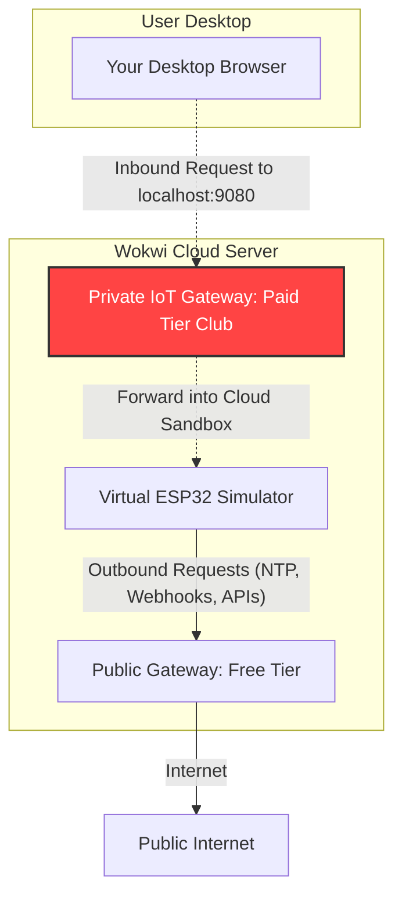

# Architectural Comparison: Wokwi Cloud vs. VS Code Simulation vs. Physical Hardware

> **Target Project (Local)**: [`Project.MM/LocalConfig`](https://github.com/b1tranger/Microprocessor_Assembly_Lab/blob/main/Project.MM/LocalConfig)  
> **Target Project (Cloud)**: [`Project.MM/CloudConfig`](https://github.com/b1tranger/Microprocessor_Assembly_Lab/blob/main/Project.MM/CloudConfig)  
> **Repository Root**: [`Project.MM/`](https://github.com/b1tranger/Microprocessor_Assembly_Lab/blob/main/Project.MM)  
> **Related Reference**: [`Project.MM/doc/research/[Cloud]implementationStepsMM.PDF.pdf`](https://github.com/b1tranger/Microprocessor_Assembly_Lab/blob/main/Project.MM/doc/research/%5BCloud%5DimplementationStepsMM.PDF.pdf)  
> **Hardware Evaluation**: [`Project.MM/doc/research/__which_one_would_be_better_for_the_project_.md`](https://github.com/b1tranger/Microprocessor_Assembly_Lab/blob/main/Project.MM/doc/research/__which_one_would_be_better_for_the_project_.md)

---

## Table of Contents
- [1. Executive Overview](#1-executive-overview)
- [2. Localhost vs. LAN Accessibility: Can Other Devices Connect?](#2-localhost-vs-lan-accessibility-can-other-devices-connect)
  - [2.1 How Localhost Works in the VS Code Simulation](#21-how-localhost-works-in-the-vs-code-simulation)
  - [2.2 Accessing the Simulated NAS from Phones & Other PCs on the LAN](#22-accessing-the-simulated-nas-from-phones--other-pcs-on-the-lan)
  - [2.3 Is the HTTP File Server Internal or External?](#23-is-the-http-file-server-internal-or-external)
  - [2.4 Physical Hardware Networking: Zero-PC Autonomous Operation](#24-physical-hardware-networking-zero-pc-autonomous-operation)
- [3. The Wokwi Cloud Paywall Dilemma (Web vs. VS Code Extension)](#3-the-wokwi-cloud-paywall-dilemma-web-vs-vs-code-extension)
  - [3.1 Why Wokwi Web Shows "This feature is only available for paying users"](#31-why-wokwi-web-shows-this-feature-is-only-available-for-paying-users)
  - [3.2 Public Gateway vs. Private IoT Gateway Explained](#32-public-gateway-vs-private-iot-gateway-explained)
  - [3.3 The Cloud Workaround in `[Cloud]implementationStepsMM.PDF.pdf`](#33-the-cloud-workaround-in-cloudimplementationstepsmmpdfpdf)
  - [3.4 Why the VS Code Extension Bypasses the Paywall for Free](#34-why-the-vs-code-extension-bypasses-the-paywall-for-free)
- [4. Tri-Platform Architectural Comparison Matrix](#4-tri-platform-architectural-comparison-matrix)
  - [4.1 Comprehensive Comparison Table](#41-comprehensive-comparison-table)
  - [4.2 Networking Ingress & Egress Analysis](#42-networking-ingress--egress-analysis)
  - [4.3 Storage Pipeline & Filesystem Fidelity](#43-storage-pipeline--filesystem-fidelity)
- [5. Physical Hardware Implementation Blueprint](#5-physical-hardware-implementation-blueprint)
  - [5.1 Bill of Materials (BOM) & Local Sourcing](#51-bill-of-materials-bom--local-sourcing)
  - [5.2 Classic ESP32 (SPI Module) vs. ESP32-S3 (Native USB Host)](#52-classic-esp32-spi-module-vs-esp32-s3-native-usb-host)
  - [5.3 Physical Circuit Wiring & SPI Electrical Considerations](#53-physical-circuit-wiring--spi-electrical-considerations)
  - [5.4 Firmware Adaptation: Moving from Simulation to Real Silicon](#54-firmware-adaptation-moving-from-simulation-to-real-silicon)
- [6. Key Presentation Takeaways & Defense Talking Points](#6-key-presentation-takeaways--defense-talking-points)

---

## 1. Executive Overview

When developing an embedded Network Attached Storage (NAS) node and static web server, developers encounter three distinct execution environments:
1. **Wokwi Web (Cloud Browser)**: Quick prototyping, but severely hobbled by cloud gateway paywalls for inbound HTTP traffic.
2. **VS Code Local Simulation (PlatformIO + Wokwi Extension + `wokwigw`)**: Zero-cost, 100% full-featured local simulation that enables real desktop browser interaction with zero paywalls.
3. **Physical Hardware Deployment (Classic ESP32 DevKit + MicroSD SPI Breakout)**: A standalone, low-power (<1W), air-gapped embedded device that serves network requests completely natively without any host PC.

This document formally answers common architecture queries regarding **LAN accessibility**, explains the **Wokwi Cloud paywall**, and provides an engineering blueprint for **physical hardware implementation**.

---

## 2. Localhost vs. LAN Accessibility: Can Other Devices Connect?

### 2.1 How Localhost Works in the VS Code Simulation
In the active simulation workspace [`Project.MM/LocalConfig/`](https://github.com/b1tranger/Microprocessor_Assembly_Lab/blob/main/Project.MM/LocalConfig), the network bridge is launched via:
```powershell
.\wokwigw.exe --forward 9080:10.13.37.2:80
```
- The simulated ESP32 resides inside an emulated subnet at IP `10.13.37.2` listening on port `80`.
- The gateway program `wokwigw.exe` binds to TCP port `9080` on your host PC and bridges TCP packets back and forth through a local WebSocket connection (`ws://localhost:9011`) into the VS Code simulation.
- Browsing to `http://localhost:9080/` reaches the ESP32 because `localhost` refers to your computer's internal loopback interface (`127.0.0.1`).

---

### 2.2 Accessing the Simulated NAS from Phones & Other PCs on the LAN
> **Key Question**: *Does the simulation only work for localhost, or can other devices on the same Wi-Fi network access it?*

**Answer: Other devices CAN access the simulated NAS right now across the local network!**

`wokwigw.exe` binds by default to `0.0.0.0:9080` (all host network interfaces), not just `127.0.0.1`. Therefore, any smartphone, tablet, or secondary laptop connected to the same Wi-Fi router or local area network (LAN) can connect to the simulated ESP32 NAS node.

#### How to Connect from Your Phone or Secondary PC:
1. Find your host PC's local IPv4 address by running in PowerShell:
   ```powershell
   ipconfig
   ```
   *(Look for `IPv4 Address` under your Wi-Fi or Ethernet adapter, e.g., `192.168.1.105` or `10.0.0.15`).*
2. Ensure Windows Defender Firewall allows incoming connections on port `9080`:
   ```powershell
   # Run once in an elevated PowerShell to permit inbound traffic on port 9080
   New-NetFirewallRule -DisplayName "Wokwi Gateway NAS" -Direction Inbound -LocalPort 9080 -Protocol TCP -Action Allow
   ```
3. Open your mobile phone browser (connected to the same Wi-Fi router) and navigate to:
   - **NAS File Dashboard**: `http://192.168.1.105:9080/`
   - **Static Hosted Webpage**: `http://192.168.1.105:9080/site`
4. You can take a photo on your phone and upload it directly to the virtual MicroSD card in real time during a live demonstration!

---

### 2.3 Is the HTTP File Server Internal or External?
> **Key Question**: *Would setting an HTTP file server that allows devices to connect be part of the ESP32 code or an external software?*

**Answer: It is 100% internal and native to the ESP32 firmware!**

There is **no external server software** (such as Apache, Nginx, Node.js, or Python `http.server`) running on the PC.
- In [`Project.MM/LocalConfig/src/main.cpp#L16`](https://github.com/b1tranger/Microprocessor_Assembly_Lab/blob/main/Project.MM/LocalConfig/src/main.cpp#L16), the firmware instantiates:
  ```cpp
  WebServer server(80);
  ```
- This `WebServer` object compiles down to native Xtensa machine instructions that execute directly on the ESP32 microcontroller core.
- The ESP32 firmware itself parses raw TCP sockets, interprets HTTP request headers (`GET`, `POST`), constructs HTTP responses (`200 OK`, `404 Not Found`), handles multipart MIME byte streams, and directly instructs the SPI peripheral controller to read and write FAT32 storage sectors.
- `wokwigw.exe` in simulation is merely a **transparent network pipe (Layer 2/3 bridge)**; it does not generate or process any web pages.

---

### 2.4 Physical Hardware Networking: Zero-PC Autonomous Operation
> **Key Question**: *Does the physical implementation allow that natively without any host PC?*

**Answer: Yes, 100% natively and autonomously.**

On real, physical hardware, **the PC and `wokwigw.exe` are completely eliminated**. The ESP32 possesses a built-in 2.4 GHz 802.11 b/g/n Wi-Fi transceiver and internal RF power amplifiers. It can operate in two native network modes:

#### Mode 1: Station Mode (STA) — Connects to Existing Wi-Fi
```text
+-------------------+             +-----------------------+             +-------------------------+
|  Smartphone / PC  | <─ (Wi-Fi) ─> | Home / Lab Wi-Fi      | <─ (Wi-Fi) ─> | Physical ESP32 NAS Node |
|  Browser          |             | Router (192.168.1.1)  |             | IP: 192.168.1.150:80    |
+-------------------+             +-----------------------+             +-------------------------+
```
- The ESP32 connects to your lab or home router.
- The router assigns it a local IP (e.g. `192.168.1.150`).
- Any device on that Wi-Fi network navigates to `http://192.168.1.150/` on standard port 80.

#### Mode 2: Soft Access Point Mode (SoftAP) — Standalone Off-Grid Mesh
```text
+-------------------+                                                   +-------------------------+
|  Smartphone / PC  | <─────────────── Direct Wi-Fi Connection ────────> | Physical ESP32 NAS Node |
|  Browser          |                     SSID: "ESP32-NAS"             | SoftAP IP: 192.168.4.1  |
+-------------------+                                                   +-------------------------+
```
- By adding one line of code: `WiFi.softAP("ESP32-NAS-Node", "password123");`
- The physical ESP32 broadcasts its own Wi-Fi network and runs an internal DHCP server.
- You connect your phone directly to the ESP32 Wi-Fi in the middle of a forest or off-grid site and open `http://192.168.4.1/`. It requires no router, no internet, and no PC.

---

## 3. The Wokwi Cloud Paywall Dilemma (Web vs. VS Code Extension)

### 3.1 Why Wokwi Web Shows "This feature is only available for paying users"
When attempting to run the project on the web at `wokwi.com` (as referenced in [`[Cloud]implementationStepsMM.PDF.pdf`](https://github.com/b1tranger/Microprocessor_Assembly_Lab/blob/main/Project.MM/doc/research/%5BCloud%5DimplementationStepsMM.PDF.pdf)), clicking **"Enable Private Wokwi IoT Gateway"** produces an error:
```text
This feature is only available for paying users: https://wokwi.com/pricing
```

To understand why this happens, we must examine Wokwi's cloud infrastructure:



### 3.2 Public Gateway vs. Private IoT Gateway Explained

1. **The Public Gateway (Free on Wokwi Web)**:
   - Operates strictly with **outbound Network Address Translation (NAT)**.
   - The virtual ESP32 can send outbound HTTP requests, fetch weather data, or publish MQTT telemetry to internet brokers.
   - **The Inbound Block**: External devices (such as your desktop browser) cannot route incoming TCP packets backwards through Wokwi's corporate firewall into the isolated virtual machine where your simulation runs.
2. **The Private IoT Gateway (Paid Subscription on Wokwi Web)**:
   - Requires a Wokwi Club membership (\$7 to \$15/month).
   - Establishes an encrypted, bidirectional reverse tunnel from your desktop to Wokwi's cloud servers, forwarding a local host port into the cloud-hosted virtual ESP32.

---

### 3.3 The Cloud Workaround in `[Cloud]implementationStepsMM.PDF.pdf`
Because inbound browser traffic is blocked on the free cloud tier, the cloud implementation guide resorted to an ingenious internal loopback workaround:
- In [`[Cloud]implementationStepsMM.PDF.pdf#page=13-15`](https://github.com/b1tranger/Microprocessor_Assembly_Lab/blob/main/Project.MM/doc/research/%5BCloud%5DimplementationStepsMM.PDF.pdf), a FreeRTOS background task [`runClientTests`](https://github.com/b1tranger/Microprocessor_Assembly_Lab/blob/main/Project.MM/CloudConfig/sketch.ino#L239-L291) was added to the firmware:
  ```cpp
  // The ESP32 queries ITSELF over internal loopback
  http.begin("http://127.0.0.1/");
  int code = http.GET();
  ```
- **Why this worked in Cloud**: The request never crossed the internet or Wokwi's network boundary; it stayed inside the ESP32's internal lwIP network stack (`127.0.0.1`), allowing students to verify HTTP status codes (`200 OK`) and print HTML payloads to the Serial Monitor.
- **The Limitation**: You could not see or interact with the visual web dashboard in a real browser tab.

---

### 3.4 Why the VS Code Extension Bypasses the Paywall for Free
In our current local VS Code setup:
1. The Wokwi simulation runs **locally on your own PC hardware**, not on Wokwi's cloud servers.
2. The network bridge [`Project.MM/setup/wokwigw.exe`](https://github.com/b1tranger/Microprocessor_Assembly_Lab/blob/main/Project.MM/setup/wokwigw.exe) is an open-source standalone Go binary executing locally on `127.0.0.1`.
3. The Wokwi VS Code extension allows you to claim a **Free Community/Hobbyist License** directly from the VS Code Command Palette (`F1` $\rightarrow$ `Wokwi: Request a New License`).
4. **Outcome**: You get full, unrestricted, bidirectional browser access (`http://localhost:9080/`), file uploads, file downloads, and static web page rendering completely for free, without paying a single dollar.

---

## 4. Tri-Platform Architectural Comparison Matrix

### 4.1 Comprehensive Comparison Table

| Evaluation Criterion | Wokwi Web (Cloud Browser) | VS Code Local Simulation (PlatformIO + Wokwi) | Physical Hardware (ESP32 DevKit V1) |
| :--- | :--- | :--- | :--- |
| **Execution Host** | Remote Wokwi Cloud Containers | Host PC (Local CPU via QEMU/Wasm engine) | Physical Silicon (Xtensa Dual-Core LX6 @ 240MHz) |
| **Financial Cost** | Free for basic; **Paid ($7-15/mo)** for inbound web browser access | **100% Free** (Free Wokwi License + PlatformIO Core) | One-time hardware cost (~500–700 BDT / $5–$7 USD) |
| **Browser GUI Access** | ❌ **Blocked on free tier** (Requires paid Private Gateway) | ✅ **Full interactive access** via `localhost:9080` | ✅ **Native LAN/Wi-Fi access** via assigned IP on port 80 |
| **File Upload Testing** | ❌ Cannot upload files from desktop browser | ✅ Full drag-and-drop file upload from local PC | ✅ Full upload from any phone, tablet, or PC on Wi-Fi |
| **Code Modularity** | Cumbersome multi-tab management in browser | ✅ Full professional IDE (modular `.h` / `.cpp` files) | ✅ Modular compilation flashed via `esptool.py` |
| **Storage Medium** | Ephemeral virtual MicroSD (resets on reload) | Virtual FAT32 MicroSD block device | Physical FAT32 MicroSD Card (1 GB – 32 GB) |
| **Network Autonomy** | Requires active internet connection to load wokwi.com | **Works 100% offline** once dependencies are installed | **100% autonomous & air-gapped** (No internet or PC needed) |
| **Persistence of Data** | Lost upon browser tab refresh | Files seeded in RAM/virtual block device | **Non-volatile**: Data survives total power loss |
| **Boot Latency** | 3–6 seconds container spin-up | Instantaneous (< 1 second) | Instantaneous (< 400 milliseconds) |

---

### 4.2 Networking Ingress & Egress Analysis
- **Egress (Outbound)**: All three environments can make outbound requests. In cloud, outbound goes through public NAT. In VS Code, outbound uses host network sockets. On physical hardware, outbound routes through your local Wi-Fi router.
- **Ingress (Inbound)**: 
  - Wokwi Web drops all inbound SYNs unless paying for Private Gateway.
  - VS Code simulation uses `wokwigw.exe` TAP driver to bridge host TCP port `9080` to virtual MAC address `10.13.37.2:80`.
  - Physical hardware binds raw TCP sockets directly on the physical 802.11 MAC layer on port `80`.

---

### 4.3 Storage Pipeline & Filesystem Fidelity
- In the simulation environments (both Cloud and VS Code), storage is backed by a virtual RAM disk formatted as FAT32, mediated by the Arduino `SD.h` library.
- On physical hardware, the SPI bus drives an actual physical NAND flash controller embedded inside a MicroSD card. Block read/write timing, sector leveling, and wear management are handled by the card's onboard ASIC.

---

## 5. Physical Hardware Implementation Blueprint

### 5.1 Bill of Materials (BOM) & Local Sourcing

To build this physical project for demonstration or real-world field deployment, only three inexpensive components are required:

| Component | Specifications / Model | Estimated Cost (BDT) | Purpose |
| :--- | :--- | :--- | :--- |
| **Microcontroller** | ESP32 DevKit V1 (30-pin, ESP-WROOM-32) | ~350–450 BDT | Core 240 MHz dual-core CPU, Wi-Fi radio, web server |
| **Storage Module** | MicroSD Card SPI Adapter Module | ~60–100 BDT | Physical SPI socket with level shifters & bypass capacitors |
| **MicroSD Card** | Standard Class 10 MicroSD (4GB to 32GB) | ~200–350 BDT | Physical FAT32 block storage media |
| **Jumper Wires** | Female-to-Female Dupont Wires (6 wires) | ~20 BDT | Interconnecting SPI bus and power rails |
| **Total Cost** | — | **~630–920 BDT ($6–$8)** | Complete autonomous, battery-powered edge NAS |

---

### 5.2 Classic ESP32 (SPI Module) vs. ESP32-S3 (Native USB Host)
As detailed in [`__which_one_would_be_better_for_the_project_.md`](https://github.com/b1tranger/Microprocessor_Assembly_Lab/blob/main/Project.MM/doc/research/__which_one_would_be_better_for_the_project_.md), students often ask: *"Should we use an ESP32-S3 so we can plug in a standard USB pen drive instead of an SD card?"*

```text
+----------------------------------------------------+----------------------------------------------------+
| CLASSIC ESP32 + SPI MICROSD MODULE (RECOMMENDED)   | ESP32-S3 + USB PEN DRIVE (ALTERNATIVE)            |
+----------------------------------------------------+----------------------------------------------------+
| 1. Matches the proposal pinout table perfectly.    | 1. Requires revising pinout tables to FSPI bus.    |
| 2. Stable, standard Arduino SD library.            | 2. Requires complex USB Host MSC drivers.          |
| 3. Ubiquitously available in all local shops.      | 3. More expensive; sub-variants cause confusion.   |
| 4. Wokwi simulation is 100% pin-accurate.          | 4. Wokwi simulation for USB host is experimental.  |
+----------------------------------------------------+----------------------------------------------------+
```
**Conclusion**: The **Classic ESP32 with SPI MicroSD module** is the ideal choice for this lab course because it maintains 100% parity between your simulation schematics and your physical circuit board.

---

### 5.3 Physical Circuit Wiring & SPI Electrical Considerations

```text
  PHYSICAL ESP32 DEVKIT V1                       MICROSD SPI BREAKOUT MODULE
+--------------------------+                   +-----------------------------+
|                          |                   |                             |
|       [GPIO 5]  (D5)  ---|-------------------|--> [CS]                     |
|       [GPIO 18] (D18) ---|-------------------|--> [SCK / CLK]              |
|       [GPIO 23] (D23) ---|-------------------|--> [MOSI / DI]              |
|       [GPIO 19] (D19) <--|-------------------|--- [MISO / DO]              |
|       [3V3 or 5V]     ---|-------------------|--> [VCC]                    |
|       [GND]           ---|-------------------|--> [GND]                    |
|                          |                   |                             |
+--------------------------+                   +-----------------------------+
```

#### Electrical Guidelines:
1. **Module Voltage Compatibility**:
   - Most hobby MicroSD modules have an onboard 3.3V low-dropout (LDO) regulator and a 74LVC125 level-shifter chip. Connect their `VCC` pin to the ESP32's **`VIN` (5V)** pin for optimal signal cleanliness.
   - If using a raw 3.3V MicroSD adapter (without an onboard regulator), connect `VCC` directly to **`3V3`**.
2. **Wire Length**:
   - Keep SPI Dupont jumper wires under **15 cm (6 inches)**. High-frequency SPI clock pulses (up to 20–40 MHz) suffer from signal attenuation, capacitive ringing, and crosstalk if long, loose wires are used.
3. **Card Formatting**:
   - The physical card must be formatted with **FAT32** (Allocation unit size: 32 KB or 16 KB). Do not format as exFAT or NTFS, as the lightweight embedded `SD.h` FatFS driver only supports FAT16/FAT32.

---

### 5.4 Firmware Adaptation: Moving from Simulation to Real Silicon

To flash the active code [`Project.MM/LocalConfig/src/main.cpp`](https://github.com/b1tranger/Microprocessor_Assembly_Lab/blob/main/Project.MM/LocalConfig/src/main.cpp) onto a physical ESP32, only **two small lines need updating**:

#### Change 1: Provide Real Wi-Fi Credentials
In `src/main.cpp#L13-L14`:
```cpp
// SIMULATION (Wokwi):
// const char* ssid = "Wokwi-GUEST";
// const char* password = "";

// PHYSICAL HARDWARE (Your home or mobile hotspot Wi-Fi):
const char* ssid = "MyHomeWiFi";
const char* password = "MySecretPassword";
```

#### Change 2: Optional SoftAP Mode (True Standalone Off-Grid Operation)
If you want to demonstrate the physical device in the classroom without depending on university Wi-Fi:
In `src/main.cpp#L278-L286`, replace `WiFi.begin()` with:
```cpp
// Start autonomous Access Point
WiFi.softAP("ESP32-Edge-NAS", "12345678");
Serial.printf("[NET] AP SSID: ESP32-Edge-NAS | IP: %s\n", WiFi.softAPIP().toString().c_str());
```
Now, anyone in the classroom can connect their phone directly to the `"ESP32-Edge-NAS"` Wi-Fi and open `http://192.168.4.1/`.

#### Change 3: Flashing Command
Plug the physical ESP32 into your PC via USB cable, open PowerShell in `Project.MM/LocalConfig`, and run:
```powershell
python -m platformio run --target upload
```
PlatformIO automatically detects the COM port, puts the ESP32 into bootloader mode, flashes the 1.24 MB binary, and restarts the microcontroller.

---

## 6. Key Presentation Takeaways & Defense Talking Points

1. **Localhost is just a bridge**: The simulation runs on localhost because `wokwigw.exe` bridges the sandboxed virtual TAP device to your PC. Opening Windows Firewall allows any smartphone on the LAN to access the simulated file server immediately.
2. **The Server is Autonomous**: The HTTP server is embedded in the ESP32 C++ firmware; it does not rely on any third-party server software on the host.
3. **The Wokwi Paywall is Cloud-Only**: The "paying users only" limitation is an inbound routing restriction enforced by Wokwi's cloud servers. Running locally in VS Code with PlatformIO and `wokwigw.exe` completely bypasses the paywall for free.
4. **Physical Deployment is Seamless**: The classic ESP32 with an external SPI MicroSD module matches the simulation pin-for-pin (`D5`, `D18`, `D19`, `D23`). Flashing the physical board requires nothing more than entering real Wi-Fi credentials.
